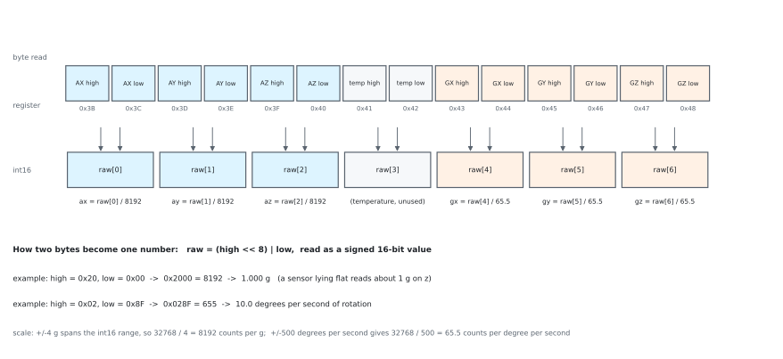
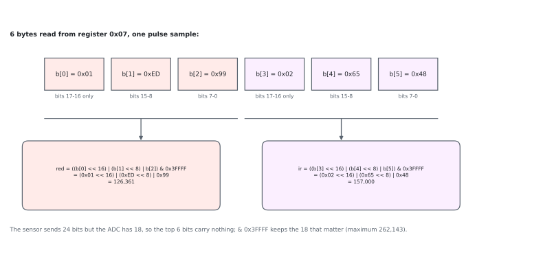
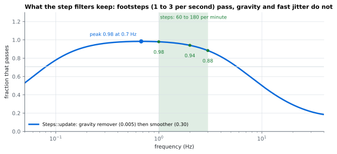
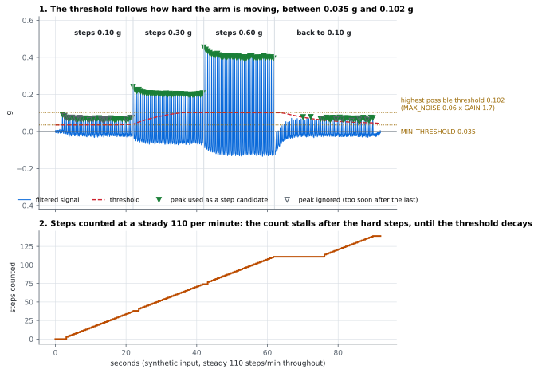
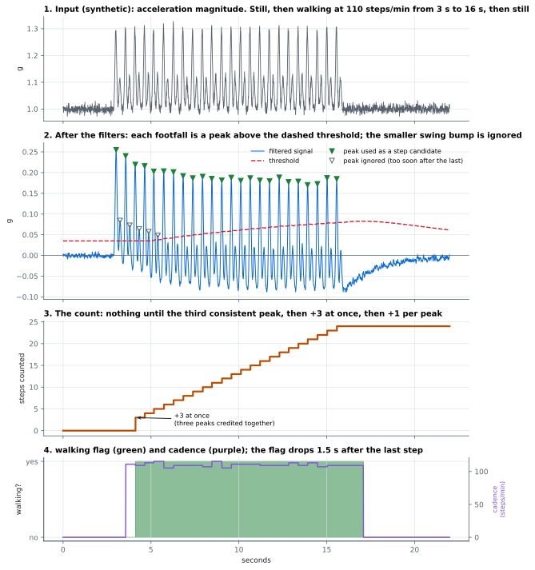
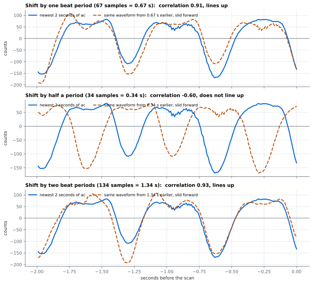
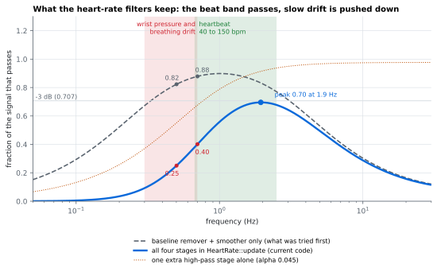
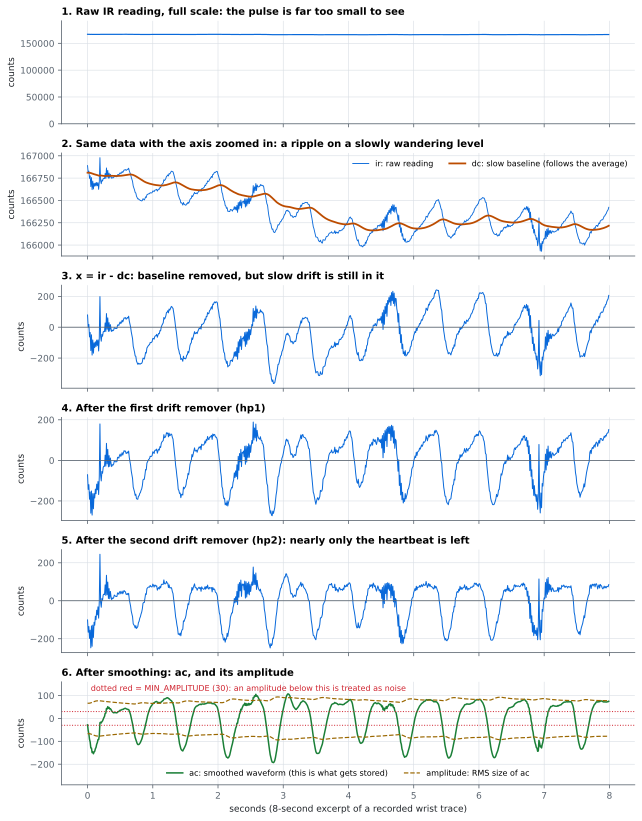
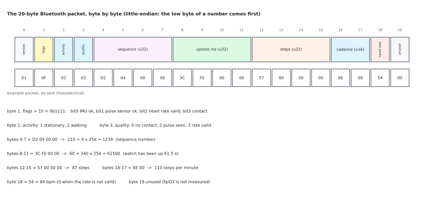
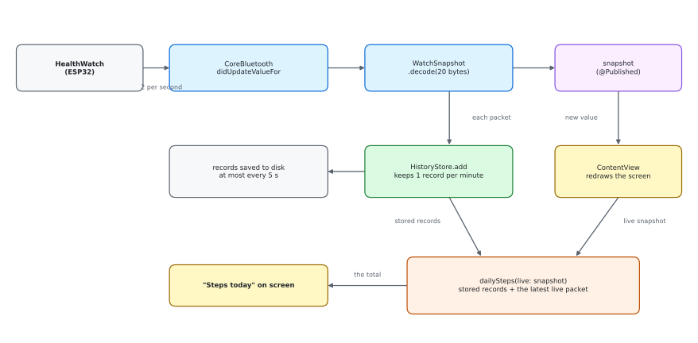

# HealthWatch code guide

A line-by-line study guide to the HealthWatch prototype: a wrist wearable built from an ESP32 board, an MPU6050 motion sensor and a MAX30102 pulse sensor, plus an iPhone app that shows what the watch measures.

It explains **every non-blank line of code** in the firmware (`HealthWatch/`), the iPhone app (`ios/`) and the replay tools (`replay/`), and it uses graphs to show how the code behaves, so the behaviour can be studied and not only the syntax. It does not cover the old full-featured version in `archive/`, the Xcode project file, or the scripts in `docs/tools/` that make the figures.

## How to read this guide

- Each file has its own section. The code is shown in numbered blocks; the number on the left is the real line number in the file. After each block comes an explanation of what those lines do and why they are written that way.
- The code blocks are copied from the actual files when this guide is built, and the build refuses to finish if a line of code has no explanation. So the code shown here is the code that exists.
- A few neighbouring lines that do exactly the same job on different data (for example, converting the x, y and z readings) are explained together. Blank lines are not shown. Comments are shown with the code they sit in.
- Where a graph helps, it appears right after the lines that produce the behaviour. The figures are numbered in order of first appearance.
- Suggested order: skim this page, read the sketch, then read each module in the order it is called. If you want to study only one thing, the heart-rate code and its graphs are the richest part.

## Where the graphs come from

The graphs are not drawings of what the code is supposed to do. Each one was made by running the **real source files** on real or synthetic input and plotting what they computed.

| Figures | Input | Notes |
|---|---|---|
| Heart-rate filters, stages, correlation, timeline, rule-by-rule comparison | Recorded 100 Hz pulse-sensor traces from this watch: a fingertip (60 s), the wrist hand-held (30 s and 60 s) and the wrist strapped to its back (60 s) | The traces are the author's own measurements and are not stored in the repository. The timeline graph shows a trace in which the watch reports a heart rate only about a third of the time. |
| Step counter graphs | **Synthetic** acceleration made by a script: gravity plus noise plus bumps at chosen times | No recording of real walking exists yet, so the step graphs show the logic's behaviour on idealised input, not how accurate it is on a real wrist. |
| Byte layouts, FIFO, flowcharts, timing | Diagrams | The numbers in the byte diagrams are computed in code, not typed. The timing zoom is a schematic and says so. |
| Step total on the phone | Simulation of the app's rule | Illustrates one rule in `HistoryStore.swift`. |

The recorded traces have **no independent heart-rate reference** (no chest strap or counted pulse), so none of these graphs says the heart rate shown is *correct*. They show how the code decides.

## Units and words used

- **Hz**: times per second. **ms**: milliseconds (a thousandth of a second). **µs**: microseconds (a millionth).
- **g**: the acceleration of gravity. A sensor lying still reads about 1 g. **dps**: degrees per second, a rotation rate.
- **bpm**: beats per minute. **counts**: the raw whole-number readings of an analogue-to-digital converter.

## Glossary

| Term | Meaning |
|---|---|
| **Sample** | One measurement. The sensors here take 100 samples per second. |
| **I2C** | A two-wire connection (data wire SDA, clock wire SCL) that lets one microcontroller talk to several chips, each with its own address. |
| **Register** | A numbered storage cell inside a chip. Writing one changes a setting; reading one gets a measurement or a status. |
| **ADC** | Analogue-to-digital converter: turns a light level or a voltage into a whole number. 18-bit means numbers from 0 to 262,143. |
| **FIFO** | "First in, first out": a queue. The pulse sensor writes samples into a 32-entry queue until the microcontroller reads them. |
| **Baseline (DC)** | The slowly changing average level of a signal. |
| **AC component** | What is left after the baseline is removed: the fast ripple, here the heartbeat. |
| **Filter** | A calculation that keeps some speeds of change and removes others. A *high-pass* filter removes slow changes; a *low-pass* filter removes fast ones. |
| **Correlation** | A number from -1 to 1 for how closely two series rise and fall together. 1 means identical shape. |
| **Ring buffer** | An array used as a circle: writing past the end wraps around to the start, overwriting the oldest value. |
| **Little-endian** | Storing a multi-byte number with the low byte first. |
| **BLE** | Bluetooth Low Energy. The watch advertises; the phone connects; the watch *notifies* the phone each time a value changes. |
| **Header file / source file** | In C++, a `.h` file declares what a class contains and a `.cpp` file holds the working code. |
| **Constructor** | A function that runs automatically when an object is created. |

## Contents

**Part 1. The watch firmware**

1. [HealthWatch.ino: the sketch](#sec-1) (`HealthWatch/HealthWatch.ino`, 81 lines)
2. [IMU.h: the motion sensor's declaration](#sec-2) (`HealthWatch/src/IMU.h`, 24 lines)
3. [IMU.cpp: talking to the MPU6050](#sec-3) (`HealthWatch/src/IMU.cpp`, 51 lines)
4. [MAX30102.h: the pulse sensor's declaration](#sec-4) (`HealthWatch/src/MAX30102.h`, 26 lines)
5. [MAX30102.cpp: the pulse sensor driver](#sec-5) (`HealthWatch/src/MAX30102.cpp`, 78 lines)
6. [Steps.h: the step counter's declaration](#sec-6) (`HealthWatch/src/Steps.h`, 29 lines)
7. [Steps.cpp: counting steps](#sec-7) (`HealthWatch/src/Steps.cpp`, 109 lines)
8. [HeartRate.h: the heart-rate calculator's declaration](#sec-8) (`HealthWatch/src/HeartRate.h`, 36 lines)
9. [HeartRate.cpp: finding the heartbeat](#sec-9) (`HealthWatch/src/HeartRate.cpp`, 147 lines)
10. [Bluetooth.h: the Bluetooth module's declaration](#sec-10) (`HealthWatch/src/Bluetooth.h`, 36 lines)
11. [Bluetooth.cpp: advertising and sending the packet](#sec-11) (`HealthWatch/src/Bluetooth.cpp`, 68 lines)

**Part 2. The iPhone app**

12. [HealthWatchApp.swift: the app's entry point](#sec-12) (`ios/HealthWatch/HealthWatchApp.swift`, 21 lines)
13. [BLEProtocol.swift: understanding the 20-byte packet](#sec-13) (`ios/HealthWatch/BLEProtocol.swift`, 66 lines)
14. [BluetoothManager.swift: finding and talking to the watch](#sec-14) (`ios/HealthWatch/BluetoothManager.swift`, 83 lines)
15. [HistoryStore.swift: remembering readings and totalling steps](#sec-15) (`ios/HealthWatch/HistoryStore.swift`, 75 lines)
16. [ContentView.swift: the screens](#sec-16) (`ios/HealthWatch/ContentView.swift`, 97 lines)

**Part 3. The replay and capture tools**

17. [ppg_replay.cpp: replaying a recording on the computer](#sec-17) (`replay/ppg_replay.cpp`, 40 lines)
18. [build.sh: compiling the replay tool](#sec-18) (`replay/build.sh`, 4 lines)
19. [capture_ppg.py: recording a trace from the live board](#sec-19) (`replay/capture_ppg.py`, 91 lines)

**Appendices**

- Appendix A: known quirks and limits
- Appendix B: regenerating this guide
- Figure index (below)

*444 explained blocks covering 1012 non-blank lines of code in 19 files, with 20 figures.*

---

# Part 1. The watch firmware

The code that runs on the ESP32. Start with the sketch, then the two sensor drivers, then the two algorithms, then Bluetooth.

<a id="sec-1"></a>

## 1. HealthWatch.ino: the sketch

`HealthWatch/HealthWatch.ino`

The sketch is the conductor. It owns one object per module, starts the hardware in `setup()`, and then `loop()` runs forever, checking the clock and doing whatever is due: read the motion sensor, drain the pulse sensor, print, notify the phone, answer a Serial command. It contains no signal processing itself; that lives in the modules.

Arduino calls `setup()` once after power-up or reset, then calls `loop()` over and over. There is no operating system scheduler here: `loop()` is a single thread that must keep coming back around fast enough that no job is late.


*Figure 1. The whole system. Everything in the middle column runs inside `loop()`.*

**Line 1**

```cpp
  1  #include <Wire.h>
```

Brings in Arduino's I2C library. It provides a global object called `Wire`, which every driver uses to talk to the two sensors over the two-wire I2C bus. This sketch needs it directly for `Wire.begin` and `Wire.setClock` in `setup()`.

**Lines 2 to 6**

```cpp
  2  #include "src/IMU.h"
  3  #include "src/MAX30102.h"
  4  #include "src/Steps.h"
  5  #include "src/HeartRate.h"
  6  #include "src/Bluetooth.h"
```

One include per module. Quotes (instead of angle brackets) tell the compiler to look in the sketch's own folder first; `src/` is where the module files live, and the Arduino tools compile every `.cpp` file found there. `Bluetooth.h` pulls in the NimBLE library, which must be installed from Library Manager.

**Line 8**

```cpp
  8  //Timing
```

A comment. In this code base every comment starts with `//` with no space after it, following the style of the author's reference `Steps.cpp`.

**Line 9**

```cpp
  9  static const uint32_t IMU_PERIOD_US = 10000;      //100 Hz
```

`IMU_PERIOD_US` is how long one IMU time slot lasts: 10,000 microseconds = 10 ms = 100 slots per second. `static const` means the value never changes and is private to this file. `uint32_t` is an unsigned 32-bit integer, big enough for about 71.6 minutes of microseconds before it wraps back to zero (the explanation at line 39 shows why that does not matter).

**Line 10**

```cpp
 10  static const uint32_t PRINT_PERIOD_MS = 100;      //Serial readout 10 times per second
```

`PRINT_PERIOD_MS`: one Serial Monitor line every 100 ms, so ten lines per second. Fast enough to watch the pulse ripple, slow enough to read.

**Line 11**

```cpp
 11  static const uint32_t BLE_PERIOD_MS = 500;        //Phone update twice per second
```

`BLE_PERIOD_MS`: one Bluetooth packet every 500 ms, so two per second. This was 1000 ms originally; halving it makes the step count on the phone move more often.

**Lines 13 to 17**

```cpp
 13  IMU imu;
 14  MAX30102 ppg;
 15  Steps steps;
 16  HeartRate heart;
 17  Bluetooth ble;
```

Creates one object of each module as a global variable. Global objects are built before `setup()` runs, so their constructors must not touch hardware (the I2C bus is not started yet). They only set their variables. `HeartRate`'s constructor calls `reset()`, which zeroes its 400-entry history buffer.

**Line 19**

```cpp
 19  bool imuOk = false, ppgOk = false;
```

Whether each sensor answered at boot. `imuOk` and `ppgOk` are filled in `setup()`. They are sent to the phone in every packet. **They are never updated afterwards**, so if a sensor dies after boot the phone still shows it as ready.

**Line 20**

```cpp
 20  bool rawStream = false;                           //Print every pulse sample as CSV (p to start, s to stop)
```

When `true`, every pulse sample is printed as `timestamp,red,ir` so a trace can be recorded with `replay/capture_ppg.py`. It is switched with the Serial commands `p` and `s` at the bottom of `loop()`.

**Line 21**

```cpp
 21  uint32_t nextImuUs = 0, nextPrintMs = 0, nextBleMs = 0;
```

Three deadlines, one per timed job: the next IMU slot (in microseconds), the next Serial line and the next Bluetooth packet (in milliseconds). `loop()` compares the clock to these every pass. Microseconds are used for the 10 ms IMU grid because it needs finer timing than milliseconds give.

**Line 23**

```cpp
 23  void setup() {
```

`setup()` runs exactly once, at power-up or when you press the reset button.

**Line 24**

```cpp
 24    Serial.begin(115200);
```

Starts the USB serial port at 115200 bits per second. Serial Monitor must be set to the same speed or you will see garbage. It does not wait for a computer to connect.

**Line 25**

```cpp
 25    Wire.begin(21, 22);
```

Starts the I2C bus with data (SDA) on GPIO 21 and clock (SCL) on GPIO 22. Those are the ESP32's default I2C pins; both sensors share these two wires.

**Line 26**

```cpp
 26    Wire.setClock(400000);
```

Sets the bus clock to 400,000 cycles per second (I2C "fast mode"). The default is 100 kHz. At 400 kHz reading a sample takes a fraction of a millisecond, which keeps the loop quick.

**Lines 28 to 29**

```cpp
 28    imuOk = imu.init();
 29    ppgOk = ppg.init();
```

Starts each sensor. `init()` returns `true` if the chip answered. If one fails the sketch carries on, so a missing pulse sensor does not stop the step counter, and the reverse. Note that `ppg.init()` starts the pulse sensor sampling at 100 samples per second immediately, and its 32-sample buffer overflows after about 0.32 s if nobody reads it.

**Line 30**

```cpp
 30    Serial.printf("IMU=%d MAX30102=%d\n", imuOk, ppgOk);
```

Prints one line such as `IMU=1 MAX30102=1` so you can see at boot whether both sensors were found. `%d` prints a `bool` as 1 or 0.

**Lines 32 to 34**

```cpp
 32    ble.init("HealthWatch");
 33    nextImuUs = micros();
 34  }
```

Starts Bluetooth under the name `HealthWatch` and begins advertising, which is how the phone finds the watch. This is a slow call. While it runs `loop()` is not running, so the pulse sensor's buffer can fill; the overflow check in `MAX30102::available()` exists partly for this. Then the IMU time grid is started from the current time, so the first slot is due immediately.

**Line 36**

```cpp
 36  void loop() {
```

`loop()` is called again and again, thousands of times per second. Most passes find nothing due and finish quickly. The sensors are not interrupt driven: the sketch simply keeps asking "is it time yet?".


*Figure 2. What `loop()` does over one second, and a zoom on 40 ms.*

**Lines 37 to 38**

```cpp
 37    //Read the IMU every 10 ms and feed the step counter
 38    const uint32_t nowUs = micros();
```

Reads the microsecond clock once per pass and keeps it in `nowUs` so all the timing decisions in this pass use the same instant.

**Line 39**

```cpp
 39    if ((int32_t)(nowUs - nextImuUs) >= 0) {
```

"Is the IMU slot due?" It subtracts the deadline from the clock as **unsigned** numbers, then reinterprets the answer as signed. This is the standard way to compare times that wrap around. Example: just before the clock wraps, `nextImuUs` = 4,294,967,290 and just after it `nowUs` = 5. Plainly `5 < 4,294,967,290` looks "not yet", but `5 - 4,294,967,290` wraps to 11 as unsigned, which is a positive 11 as signed: the deadline passed 11 microseconds ago. Without this trick the watch would freeze for 71 minutes at every wrap.

**Line 40**

```cpp
 40      nextImuUs += IMU_PERIOD_US;
```

Moves the deadline forward by exactly one period. Adding to the old deadline (rather than setting it to `now + 10 ms`) keeps the slots on a perfect 10 ms grid even when this pass ran a little late. The sample rate therefore stays at 100 Hz instead of slowly drifting below it.

**Line 41**

```cpp
 41      if ((int32_t)(nowUs - nextImuUs) >= 0) nextImuUs = nowUs + IMU_PERIOD_US;   //Fell behind, resync
```

Safety net. If the loop was blocked for more than one period, the new deadline is *still* in the past. Without this line the loop would then fire several IMU reads back to back to "catch up", feeding the step counter bursts of samples that are not 10 ms apart. Instead it skips the missed slots and restarts the grid from now. Example: after a 25 ms stall, the deadline is 15 ms in the past, so it jumps to `now + 10 ms` and two samples are skipped.

**Lines 42 to 43**

```cpp
 42      if (imu.read()) steps.update(imu.ax, imu.ay, imu.az, millis());
 43    }
```

Reads the motion sensor. If the read worked, the three acceleration values go to the step counter along with the current time in milliseconds. The gyro values stay in `imu.gx/gy/gz` for the Serial print. If the read fails (`false`) the step counter simply does not see this sample.

**Line 45**

```cpp
 45    //Read every pulse sample waiting in the sensor FIFO
```

Next job: the pulse sensor.

**Line 46**

```cpp
 46    const uint32_t overflowsBefore = ppg.overflows;
```

Remembers how many overflows have happened so far, so after the loop we can tell whether one happened during it.

**Lines 47 to 50**

```cpp
 47    while (ppg.available() && ppg.read()) {
 48      heart.update(ppg.ir);
 49      if (rawStream) Serial.printf("%lu,%lu,%lu\n", (unsigned long)micros(), (unsigned long)ppg.red, (unsigned long)ppg.ir);
 50    }
```

Drains the pulse sensor's FIFO (its 32-sample buffer). `ppg.available()` is the number of unread samples; `ppg.read()` fetches the oldest into `ppg.red` and `ppg.ir`. The loop repeats until nothing is left, or a read fails. For each sample, `heart.update(ppg.ir)` feeds the infrared value to the heart-rate filter (the red value is not used by the simplified code). If `rawStream` is on, the sample is also printed as CSV. The first number there is `micros()` at the time of the read, which is **not** the moment the sensor measured it: several samples read in one pass get nearly the same number. The replay tools therefore ignore it and assume 100 samples per second.

**Lines 52 to 53**

```cpp
 52    //An overflow lost samples, so the waveform has a hole: start the heart rate over
 53    if (ppg.overflows != overflowsBefore) heart.reset();
```

If an overflow happened during that loop, samples were lost, so the stored waveform has a hole in it and the old history would give a wrong period. Calling `heart.reset()` throws the history away and starts again, at the cost of a few seconds before the next reading.

**Line 55**

```cpp
 55    const uint32_t nowMs = millis();
```

The millisecond clock, read once and used by the two slow jobs below.

**Lines 57 to 58**

```cpp
 57    //Serial Monitor: three gyro axes and the pulse reading
 58    if (!rawStream && (int32_t)(nowMs - nextPrintMs) >= 0) {
```

Is a Serial line due, and are we *not* in raw-capture mode? During a `p` capture the normal line is suppressed so that only clean CSV reaches the file.

**Line 59**

```cpp
 59      nextPrintMs = nowMs + PRINT_PERIOD_MS;
```

Schedules the next line 100 ms from now.

**Line 60**

```cpp
 60      Serial.printf("gx:%.1f,gy:%.1f,gz:%.1f,pulse:%lu", imu.gx, imu.gy, imu.gz, (unsigned long)ppg.ir);
```

Prints the three gyro rates (degrees per second, one decimal) and the latest raw infrared count. `%.1f` is a float with one decimal; `%lu` is an unsigned long, which is why `ppg.ir` is cast with `(unsigned long)`. No `\n` yet: the line continues below. The gyro values are raw sensor output with no zero-offset removal, so they read a few degrees per second even when the board is still (in testing, roughly between -4 and +3).

**Line 61**

```cpp
 61      if (heart.valid) Serial.printf("  hr=%.0f", heart.bpm);
```

Appends ` hr=84` only when the heart rate is currently valid. When it is not, the field is simply absent rather than showing a stale or zero value.

**Lines 62 to 63**

```cpp
 62      Serial.printf("  steps=%lu\n", (unsigned long)steps.count);
 63    }
```

Appends the step total and ends the line with `\n`. A finished line looks like `gx:2.3,gy:-2.5,gz:-0.8,pulse:165523  hr=84  steps=14`. The `label:value,label:value` format is also what Arduino's Serial Plotter understands, so the same output can be graphed.

**Lines 65 to 66**

```cpp
 65    //Phone update
 66    if ((int32_t)(nowMs - nextBleMs) >= 0) {
```

Is a Bluetooth packet due?

**Line 67**

```cpp
 67      nextBleMs = nowMs + BLE_PERIOD_MS;
```

Schedules the next one 500 ms from now. Unlike the IMU, this uses `now + period`, so it can drift by a few milliseconds per packet. That is irrelevant for a 2 Hz status update.

**Lines 68 to 70**

```cpp
 68      ble.send(steps.count, (uint16_t)steps.cadence, steps.walking,
 69               (uint8_t)(heart.bpm + 0.5f), heart.valid, heart.contact, imuOk, ppgOk);
 70    }
```

Builds and sends the 20-byte packet. `steps.count` is the step total; `(uint16_t)steps.cadence` turns the float cadence into a whole number by cutting off the decimals; `steps.walking` says walking or stationary; `(uint8_t)(heart.bpm + 0.5f)` rounds the heart rate to the nearest whole number (adding 0.5 before cutting off decimals is the usual rounding trick); `heart.valid` and `heart.contact` are the two flags; `imuOk` and `ppgOk` are the boot results. The call is made every 500 ms even when no phone is connected; the Bluetooth module decides whether to actually transmit.

**Lines 72 to 73**

```cpp
 72    //Serial commands
 73    while (Serial.available()) {
```

Handles typed Serial commands. `Serial.available()` is the number of waiting characters; the loop reads them one by one until none are left.

**Line 74**

```cpp
 74      const char c = Serial.read();
```

Takes one character off the input. Serial Monitor sends exactly the characters you type (with "No line ending" selected).

**Lines 75 to 78**

```cpp
 75      if (c == 'p') {
 76        Serial.println("timestamp_us,red,ir");
 77        rawStream = true;
 78      }
```

`p` means "start streaming raw samples". It prints the CSV header line `timestamp_us,red,ir` and turns `rawStream` on.

**Lines 79 to 81**

```cpp
 79      if (c == 's') rawStream = false;
 80    }
 81  }
```

`s` turns the raw stream off, which also lets the normal Serial line come back. Any other character is ignored. The final `}` ends `loop()`, and the processor immediately starts it again.

<a id="sec-2"></a>

## 2. IMU.h: the motion sensor's declaration

`HealthWatch/src/IMU.h`

A header file declares what a class contains without saying how it works; the `.cpp` file supplies the working code. Other files include the header to be allowed to use the class.

**Lines 1 to 2**

```cpp
  1  #ifndef IMU_H
  2  #define IMU_H
```

The *include guard*. `#ifndef IMU_H` means "if the name IMU_H is not defined yet"; `#define IMU_H` defines it. If a file includes this header twice (directly and through another header), the second time everything between here and `#endif` is skipped. Without the guard the compiler would see `class IMU` defined twice and stop with an error.

**Lines 4 to 5**

```cpp
  4  #include <Arduino.h>
  5  #include <Wire.h>
```

`Arduino.h` provides basic types and functions such as `uint8_t`. `Wire.h` provides the I2C `Wire` object the code in `IMU.cpp` uses.

**Lines 7 to 8**

```cpp
  7  //MPU6050 accelerometer and gyroscope over I2C
  8  class IMU{
```

A comment, then the class. A class bundles data (the sensor's latest readings) with the functions that work on it. `class IMU{` opens it, in the brace style of that same reference file.

**Lines 9 to 10**

```cpp
  9    private:
 10      bool ready;                              //Sensor answered at init
```

`private:` members can only be used inside the class's own functions. `ready` records whether the sensor answered during `init()`; `read()` refuses to do anything if it is false.

**Line 12**

```cpp
 12      bool writeReg(uint8_t reg, uint8_t value);
```

A private helper that writes one value into one of the sensor's registers. It is private because nobody outside the class should need to know the chip's register layout.

**Lines 14 to 16**

```cpp
 14    public:
 15      float ax, ay, az;                        //Acceleration in g
 16      float gx, gy, gz;                        //Rotation in degrees per second
```

`public:` members can be used from the sketch. The six values are public so the sketch can write `imu.ax` directly. `ax, ay, az` are acceleration along three axes in units of g (one g is the pull of gravity); `gx, gy, gz` are rotation rates around three axes in degrees per second. After each successful `read()` they hold the newest numbers.

**Line 18**

```cpp
 18      IMU();
```

The constructor: runs automatically when the global object `imu` is created. Its body is in `IMU.cpp`.

**Lines 20 to 21**

```cpp
 20      bool init();
 21      bool read();
```

The two operations. `init()` configures the chip and returns whether it worked. `read()` fetches one new set of readings and returns whether that worked.

**Lines 22 to 24**

```cpp
 22  };
 23
 24  #endif
```

Ends the class (note the `;` after the brace, required in C++) and ends the include guard.

<a id="sec-3"></a>

## 3. IMU.cpp: talking to the MPU6050

`HealthWatch/src/IMU.cpp`

The MPU6050 is a chip with many numbered **registers**, small storage cells that hold either settings (write them to configure the chip) or measurements (read them). I2C is the two-wire protocol used to read and write them: the ESP32 says "device 0x68, register 0x3B, give me 14 bytes" and the chip answers.

**Line 1**

```cpp
  1  #include "IMU.h"
```

Includes this module's own header so the function definitions below match the class declaration.

**Line 3**

```cpp
  3  #define MPU6050_ADDR 0x68
```

`MPU6050_ADDR` is the chip's I2C address, 0x68 (hexadecimal; 104 in decimal). Every I2C device has an address; the two sensors here have different ones (0x68 and 0x57) so they can share the two wires. `#define` is a text substitution done before compiling.

**Lines 5 to 8**

```cpp
  5  IMU::IMU() {
  6    ready = false;
  7    ax = ay = az = gx = gy = gz = 0;
  8  }
```

The constructor. Sets `ready` to false (not initialised yet) and sets all six readings to zero so that printing them before the first successful read shows 0 rather than random leftover memory. The chained `ax = ay = ... = 0` assigns the same value to each.

**Line 10**

```cpp
 10  //Write one register
```

A comment.

**Line 11**

```cpp
 11  bool IMU::writeReg(uint8_t reg, uint8_t value) {
```

Definition of the private helper. `IMU::` says this function belongs to the class.

**Line 12**

```cpp
 12    Wire.beginTransmission(MPU6050_ADDR);
```

Starts an I2C message addressed to the MPU6050. Nothing is sent on the wire yet; the bytes are collected first.

**Lines 13 to 14**

```cpp
 13    Wire.write(reg);
 14    Wire.write(value);
```

Queues two bytes: the register number to write to, then the value to put in it.

**Lines 15 to 16**

```cpp
 15    return Wire.endTransmission() == 0;
 16  }
```

`endTransmission()` actually sends the queued bytes and returns 0 if the chip acknowledged each one. The comparison `== 0` turns that into `true` or `false`, which becomes the function's result. A missing or miswired chip does not acknowledge, so the function returns false.

**Lines 18 to 19**

```cpp
 18  //Wake the sensor and set 100 Hz output, +/-4 g, +/-500 dps
 19  bool IMU::init() {
```

Configures the chip. These five register writes set its operating mode.

**Line 20**

```cpp
 20    ready = writeReg(0x6B, 0x01) &&            //Wake up, clock from gyro PLL
```

Register 0x6B, power management: the value 0x01 clears the "sleep" bit (the chip powers up asleep) and selects the gyro's own oscillator as the clock, which is steadier than the chip's internal one.

**Line 21**

```cpp
 21            writeReg(0x1A, 0x03) &&            //Low-pass filter ~44 Hz
```

Register 0x1A, low-pass filter setting 3. The chip smooths its own readings so that rapid changes faster than about 44 Hz (acceleration) and 42 Hz (rotation) are removed. Step motion is below 5 Hz, so nothing useful is lost, and noise above is. Turning this filter on also makes the internal sample clock 1 kHz, which the next line relies on.

**Line 22**

```cpp
 22            writeReg(0x19, 0x09) &&            //1 kHz / (9 + 1) = 100 Hz
```

Register 0x19, sample-rate divider. Output rate = 1000 Hz / (1 + 9) = 100 Hz. So the chip produces a fresh reading every 10 ms, matching the sketch's 10 ms slots.

**Line 23**

```cpp
 23            writeReg(0x1B, 0x08) &&            //Gyro +/-500 dps
```

Register 0x1B, gyro range: 0x08 selects plus or minus 500 degrees per second. Wrist rotation during walking peaks around 200 to 300, so 500 does not clip. A bigger range would waste resolution.

**Line 24**

```cpp
 24            writeReg(0x1C, 0x08);              //Accel +/-4 g
```

Register 0x1C, accelerometer range: 0x08 selects plus or minus 4 g. Walking impacts reach about 2 g; 4 g leaves room while keeping resolution. The five writes are joined with `&&` ("and"), so as soon as one fails the rest are skipped and `ready` becomes false.

**Lines 25 to 26**

```cpp
 25    return ready;
 26  }
```

Returns whether everything worked. Note that this version does **not** check the chip's identity register (0x75, "WHO_AM_I") the way the earlier full version did, so any device at address 0x68 that accepts writes would be accepted.

**Lines 28 to 29**

```cpp
 28  //Read acceleration and rotation; false if the sensor did not answer
 29  bool IMU::read() {
```

Reads one set of measurements. The result is `true` only if the data arrived.



*Figure 3. The 14 bytes read from the MPU6050 and how they become six numbers.*

**Line 30**

```cpp
 30    if (!ready) return false;
```

If `init()` failed, do not try. Return false immediately.

**Lines 32 to 34**

```cpp
 32    Wire.beginTransmission(MPU6050_ADDR);
 33    Wire.write(0x3B);                          //First data register
 34    if (Wire.endTransmission(false) != 0) return false;
```

Starts a write to the chip, queues register number 0x3B (the first measurement register, acceleration X high byte), and sends it with `endTransmission(false)`. The `false` means "do not release the bus": the next step is a read, and the chip needs to see a *repeated start* so it keeps the register pointer just set. A normal ending (`true`) would reset it. If the chip does not acknowledge, give up with false.

**Line 35**

```cpp
 35    if (Wire.requestFrom(MPU6050_ADDR, 14) != 14) return false;
```

Asks for 14 bytes back starting at that register: six for acceleration (X, Y, Z, two bytes each), two for temperature, six for rotation. `requestFrom` returns how many bytes actually arrived; anything other than 14 is a failed read.

**Line 37**

```cpp
 37    int16_t raw[7];                            //ax ay az temp gx gy gz
```

A working array of seven signed 16-bit numbers: ax, ay, az, temperature, gx, gy, gz.

**Lines 38 to 42**

```cpp
 38    for (int i = 0; i < 7; i++) {
 39      const uint8_t high = Wire.read();
 40      const uint8_t low = Wire.read();
 41      raw[i] = (int16_t)((high << 8) | low);
 42    }
```

Loops seven times. Each time it takes two bytes from the incoming data, the high byte first (it holds the upper 8 bits), then the low byte. `(high << 8) | low` glues them into one 16-bit number: shifting the high byte left by 8 places multiplies it by 256, then `|` merges in the low byte. The `(int16_t)` cast reads that 16-bit pattern as a signed number, so bit patterns above 0x7FFF become negative. That is how the chip reports acceleration in the opposite direction.

**Lines 44 to 46**

```cpp
 44    ax = raw[0] / 8192.0f;                     //8192 LSB per g at +/-4 g
 45    ay = raw[1] / 8192.0f;
 46    az = raw[2] / 8192.0f;
```

Converts raw counts into g. At the plus or minus 4 g setting the 16-bit range spans 8 g, so one g is 32768 / 4 = 8192 counts. A sensor lying flat reads about 8192 on its vertical axis, so `8192 / 8192.0f` = 1.0 g. The `f` makes the constants floating-point rather than whole numbers, so the division keeps its decimals.

**Lines 47 to 49**

```cpp
 47    gx = raw[4] / 65.5f;                       //65.5 LSB per dps at +/-500 dps
 48    gy = raw[5] / 65.5f;
 49    gz = raw[6] / 65.5f;
```

Converts raw counts into degrees per second. At plus or minus 500 degrees per second, 32768 / 500 = 65.5 counts per degree per second. Index 3 (temperature) is skipped, which is why gx uses `raw[4]`. There is no zero-offset removal: a gyro lying still reads a small constant number (typically a few degrees per second) and that is shown as is.

**Lines 50 to 51**

```cpp
 50    return true;
 51  }
```

Success. The six public values now hold the newest readings.

<a id="sec-4"></a>

## 4. MAX30102.h: the pulse sensor's declaration

`HealthWatch/src/MAX30102.h`

The MAX30102 shines a red and an infrared LED into the skin and measures how much light comes back with a photodiode. Blood absorbs light, so each heartbeat makes the returned light dip by about a tenth of a percent. The chip digitises the light 100 times per second and stores the readings in a 32-entry buffer called a FIFO (first in, first out) until the microcontroller reads them.

**Lines 1 to 2**

```cpp
  1  #ifndef MAX30102_H
  2  #define MAX30102_H
```

Include guard, as in `IMU.h`.

**Lines 4 to 5**

```cpp
  4  #include <Arduino.h>
  5  #include <Wire.h>
```

Arduino basics and the I2C `Wire` object.

**Lines 7 to 8**

```cpp
  7  //MAX30102 pulse sensor over I2C
  8  class MAX30102{
```

Comment and class opening.

**Lines 9 to 10**

```cpp
  9    private:
 10      bool ready;                              //Sensor answered at init
```

Private state: whether the chip answered at init.

**Lines 12 to 13**

```cpp
 12      bool writeReg(uint8_t reg, uint8_t value);
 13      uint8_t readReg(uint8_t reg);
```

Two private helpers: write one register, read one register. Reading is needed here because the code asks the chip for its FIFO pointers.

**Lines 15 to 16**

```cpp
 15    public:
 16      uint32_t red, ir;                        //Latest sample, 18-bit ADC counts
```

The latest sample. `red` and `ir` are the light levels as 18-bit ADC counts, so between 0 and 262,143. Typical on a wrist: IR around 130,000 to 170,000. They are public so the sketch can pass `ppg.ir` straight to the heart-rate code.

**Line 17**

```cpp
 17      uint32_t overflows;                      //Times the FIFO filled up and was cleared
```

Counts how many times the FIFO filled up and had to be cleared. The sketch watches this number to know when samples were lost.

**Line 19**

```cpp
 19      MAX30102();
```

The constructor.

**Lines 21 to 23**

```cpp
 21      bool init();
 22      uint8_t available();
 23      bool read();
```

The three operations: `init()` configures the chip; `available()` says how many unread samples are in the FIFO; `read()` fetches the next one.

**Lines 24 to 26**

```cpp
 24  };
 25
 26  #endif
```

End of class and of the include guard.

<a id="sec-5"></a>

## 5. MAX30102.cpp: the pulse sensor driver

`HealthWatch/src/MAX30102.cpp`

Same pattern as the IMU driver, with one extra idea: the sensor writes samples into its own FIFO at its own pace (100 per second) and the microcontroller picks them up whenever it gets around to it. Two pointers inside the chip track this: the **write pointer** says where the chip will put the next sample, the **read pointer** says where the microcontroller will read the next one. The difference is the number of unread samples.

**Line 1**

```cpp
  1  #include "MAX30102.h"
```

Own header.

**Line 3**

```cpp
  3  #define MAX30102_ADDR 0x57
```

The chip's I2C address, 0x57.

**Line 5**

```cpp
  5  static const uint8_t LED_CURRENT = 0x2C;          //44 = 8.8 mA per LED; best wrist result in testing
```

The LED drive current as a register value. Each count is 0.2 mA, so 0x2C = 44 counts = 8.8 mA per LED. This came from a sweep on the wrist: 100 (20 mA) saturated the ADC on every sample, and 44 gave the most valid heart-rate time. It sits in one named constant so it is easy to change.

**Lines 7 to 10**

```cpp
  7  MAX30102::MAX30102() {
  8    ready = false;
  9    red = ir = overflows = 0;
 10  }
```

Constructor: not ready, latest readings zero, no overflows yet. `red = ir = overflows = 0` assigns all three at once.

**Lines 12 to 18**

```cpp
 12  //Write one register
 13  bool MAX30102::writeReg(uint8_t reg, uint8_t value) {
 14    Wire.beginTransmission(MAX30102_ADDR);
 15    Wire.write(reg);
 16    Wire.write(value);
 17    return Wire.endTransmission() == 0;
 18  }
```

Writes one register, exactly like the IMU's helper but addressed to 0x57. Returns true if the chip acknowledged.

**Lines 20 to 21**

```cpp
 20  //Read one register; 0 on failure
 21  uint8_t MAX30102::readReg(uint8_t reg) {
```

Reads one register. Returns 0 if anything fails, which is ambiguous with a real value of 0, so callers must treat 0 carefully.

**Lines 22 to 24**

```cpp
 22    Wire.beginTransmission(MAX30102_ADDR);
 23    Wire.write(reg);
 24    if (Wire.endTransmission(false) != 0) return 0;
```

Starts a write, queues the register number, and sends it with `endTransmission(false)` so the bus stays held for the repeated start. A failure returns 0.

**Lines 25 to 26**

```cpp
 25    if (Wire.requestFrom(MAX30102_ADDR, 1) != 1) return 0;
 26    return Wire.read();
```

Asks for exactly one byte back. If it did not arrive, return 0, otherwise return the byte.

**Line 27**

```cpp
 27  }
```

Closing brace of `readReg`.

**Lines 29 to 30**

```cpp
 29  //Reset and start red + IR sampling at 100 Hz, 18-bit
 30  bool MAX30102::init() {
```

Configures the chip for red + infrared sampling.

**Line 31**

```cpp
 31    if (readReg(0xFF) != 0x15) return false;   //Part ID
```

Reads register 0xFF, the part identity, which must be 0x15 for a MAX30102. This guards against the wrong chip or a dead bus, and it is the one place the code checks identity.

**Lines 32 to 33**

```cpp
 32    writeReg(0x09, 0x40);                      //Reset
 33    delay(10);
```

Register 0x09 = 0x40 sets the reset bit, which returns every register to its power-on value. The chip needs a few milliseconds to finish, so `delay(10)` waits 10 ms. This is the only blocking wait in the code and it happens once at boot.

**Lines 34 to 36**

```cpp
 34    ready = writeReg(0x04, 0) &&               //FIFO write pointer
 35            writeReg(0x05, 0) &&               //FIFO overflow counter
 36            writeReg(0x06, 0) &&               //FIFO read pointer
```

Clears the three FIFO registers: write pointer (0x04), overflow counter (0x05) and read pointer (0x06). All three at zero means "empty, nothing lost".

**Line 37**

```cpp
 37            writeReg(0x08, 0x00) &&            //No averaging, no rollover
```

Register 0x08 = 0x00: no sample averaging on the chip, and **rollover disabled**. Rollover would make a full FIFO overwrite its oldest samples. With it off, a full FIFO stops accepting new samples and counts them as lost in the overflow counter. This matters for `available()` below.

**Line 38**

```cpp
 38            writeReg(0x0A, 0x27) &&            //100 samples/s, 411 us pulse, 18-bit
```

Register 0x0A = 0x27 packs three settings. Bits 6 to 5 = 01: ADC full scale 4096 nA. Bits 4 to 2 = 001: 100 samples per second. Bits 1 to 0 = 11: pulse width 411 microseconds, which gives the full 18-bit resolution. 18 bits matters because the heartbeat is only about 0.1% of the signal: out of 150,000 counts, the beat is about 150.

**Lines 39 to 40**

```cpp
 39            writeReg(0x0C, LED_CURRENT) &&     //Red LED
 40            writeReg(0x0D, LED_CURRENT) &&     //IR LED
```

Registers 0x0C and 0x0D set the red and infrared LED currents to the value in `LED_CURRENT`.

**Line 41**

```cpp
 41            writeReg(0x09, 0x03);              //SpO2 mode: red + IR
```

Register 0x09 = 0x03: start measuring in "SpO2 mode", which samples the red and infrared LEDs alternately. This line is last on purpose: sampling begins here, after everything else is configured.

**Lines 42 to 43**

```cpp
 42    return ready;
 43  }
```

Returns whether all eight writes succeeded.


*Figure 4. How `available()` counts unread samples, including when the pointers wrap around and when the buffer is full.*

**Lines 45 to 47**

```cpp
 45  //Samples waiting in the 32-entry FIFO
 46  uint8_t MAX30102::available() {
 47    if (!ready) return 0;
```

How many unread samples are waiting. Returns 0 if the chip is not ready.

**Lines 49 to 50**

```cpp
 49    //The FIFO filled up while the loop was busy. A full FIFO has wr == rd, which
 50    //looks empty, so it would never be read again. Clear it and start fresh
```

A comment explaining the next block. It is the fix for a real failure mode: if the loop is stalled for about 0.32 s (the time to produce 32 samples), the FIFO is full and the chip stops writing.

**Lines 51 to 57**

```cpp
 51    if (readReg(0x05) != 0) {
 52      writeReg(0x04, 0);
 53      writeReg(0x05, 0);
 54      writeReg(0x06, 0);
 55      overflows++;
 56      return 0;
 57    }
```

Reads the overflow counter. Non-zero means samples were lost because the FIFO was full. A full FIFO has its write pointer equal to its read pointer, which is exactly what an *empty* FIFO looks like, so the subtraction below would report zero samples forever and the sketch would never read the chip again. So when overflow is seen, the three pointer registers are cleared (starting fresh), the `overflows` counter is raised so the sketch knows samples were lost, and 0 is returned. (An earlier simplified version of this driver lacked this check; it was added while this guide was being written.)

**Lines 59 to 62**

```cpp
 59    const uint8_t wr = readReg(0x04);
 60    const uint8_t rd = readReg(0x06);
 61    return (wr - rd) & 0x1F;
 62  }
```

The normal case. Read the write pointer and the read pointer; both are 5-bit numbers, 0 to 31. `(wr - rd) & 0x1F` is the count of samples between them. The subtraction can go negative when the write pointer has wrapped past 31 back to 0 (for example wr = 3, rd = 30 gives -27), and masking with `0x1F` (binary 11111, keep only the low 5 bits) turns -27 into 5, which is the right answer because 30, 31, 0, 1, 2 are five cells. The function returns that count.

**Lines 64 to 65**

```cpp
 64  //Read one sample from the FIFO into red and ir
 65  bool MAX30102::read() {
```

Reads one sample (red and infrared) from the FIFO.



*Figure 5. Six bytes become two 18-bit numbers.*

**Lines 66 to 68**

```cpp
 66    Wire.beginTransmission(MAX30102_ADDR);
 67    Wire.write(0x07);                          //FIFO data register
 68    if (Wire.endTransmission(false) != 0) return false;
```

Starts a write to the chip, queues register 0x07 (FIFO data), and sends it with a repeated start. Reading register 0x07 is special: each byte read comes from the FIFO, and when a whole sample has been read the chip advances its read pointer by itself. The code never writes the read pointer in normal operation.

**Line 69**

```cpp
 69    if (Wire.requestFrom(MAX30102_ADDR, 6) != 6) return false;
```

Asks for 6 bytes: three for red, three for infrared. Fewer means a failed read.

**Lines 71 to 73**

```cpp
 71    uint8_t b[6];
 72    for (int i = 0; i < 6; i++)
 73      b[i] = Wire.read();
```

Copies the six incoming bytes into a small array `b`.

**Lines 75 to 76**

```cpp
 75    red = (((uint32_t)b[0] << 16) | ((uint32_t)b[1] << 8) | b[2]) & 0x3FFFF;
 76    ir = (((uint32_t)b[3] << 16) | ((uint32_t)b[4] << 8) | b[5]) & 0x3FFFF;
```

Builds each 18-bit number from its three bytes. The first byte is shifted left 16 places, the second 8, the third not at all, and they are merged with `|`. The `(uint32_t)` casts make the shifting happen in 32 bits (a plain `uint8_t` shifted left by 16 would overflow). `& 0x3FFFF` (18 ones in binary) keeps only the 18 bits the converter produces; the top 6 bits of the 24 are not used. Worked example: bytes 0x01, 0xED, 0x99 give 0x01ED99 = 126,361.

**Lines 77 to 78**

```cpp
 77    return true;
 78  }
```

Success. `red` and `ir` hold the newest sample.

<a id="sec-6"></a>

## 6. Steps.h: the step counter's declaration

`HealthWatch/src/Steps.h`

The step counter watches how hard the sensor accelerates. Each footfall makes a short jolt; the code finds those jolts, checks that they arrive at a steady rhythm, and counts them. A single bump does not count. Walking has to be *confirmed* by three evenly spaced jolts first.

**Lines 1 to 2**

```cpp
  1  #ifndef STEPS_H
  2  #define STEPS_H
```

Include guard (see `IMU.h`).

**Line 4**

```cpp
  4  #include <stdint.h>
```

Basic integer types such as `uint32_t`.

**Lines 6 to 7**

```cpp
  6  //Step counter on acceleration magnitude with cadence confirmation
  7  class Steps{
```

Comment and class opening.

**Lines 8 to 9**

```cpp
  8    private:
  9      float baseline;                          //Slow average of magnitude, about 1 g
```

`baseline` is a slow running average of the acceleration magnitude, about 1.0 g because gravity is always pulling. Subtracting it leaves only the *changes*.

**Line 10**

```cpp
 10      float filtered, prevFiltered, prevPrevFiltered;   //Smoothed signal and two past values
```

`filtered` is the current smoothed change; `prevFiltered` and `prevPrevFiltered` are the two samples before it. Three consecutive values are what is needed to tell whether the middle one was a peak (higher than both neighbours).

**Line 11**

```cpp
 11      float noise;                             //Slow average of signal activity
```

`noise` is a slow average of how big the filtered signal has been recently, in other words how vigorously the arm is moving.

**Line 12**

```cpp
 12      float threshold;                         //Adaptive peak threshold
```

`threshold` is the height a peak must exceed. It is computed from `noise`, so it rises when the arm moves hard and falls when it moves gently.

**Line 13**

```cpp
 13      uint32_t lastPeakMs;                     //Time of the last accepted peak
```

The time in milliseconds of the last peak that was accepted as a timing reference. Zero means "none yet".

**Line 14**

```cpp
 14      uint32_t lastMotionMs;                   //Time of the last consistent peak
```

The time of the last peak that was part of a consistent rhythm. The walking timeout is measured from this.

**Line 15**

```cpp
 15      uint32_t previousIntervalMs;             //Interval between the last two peaks
```

The gap between the last two accepted peaks, used to check that the next gap is similar.

**Line 16**

```cpp
 16      uint8_t candidateCount;                  //Consistent peaks seen so far
```

How many peaks of the current rhythm have been seen. When it reaches 3 walking is confirmed.

**Lines 18 to 21**

```cpp
 18    public:
 19      uint32_t count;                          //Steps since boot
 20      bool walking;                            //Walking confirmed
 21      float cadence;                           //Steps per minute while walking
```

The public results. `count` is the step total since boot; `walking` is true while a rhythm is confirmed; `cadence` is the current pace in steps per minute.

**Line 23**

```cpp
 23      Steps();
```

Constructor.

**Lines 25 to 26**

```cpp
 25      void reset();
 26      void update(float ax, float ay, float az, uint32_t nowMs);
```

`reset()` clears everything. `update()` is called once per IMU sample, 100 times per second, with the three acceleration values and the time in milliseconds.

**Lines 27 to 29**

```cpp
 27  };
 28
 29  #endif
```

End of class and include guard.

<a id="sec-7"></a>

## 7. Steps.cpp: counting steps

`HealthWatch/src/Steps.cpp`

The whole algorithm in one picture first; the code below follows this order from top to bottom.


*Figure 6. Every decision `Steps::update` makes, in order. Each yellow diamond is an `if` in the code; each side box is a `return` or a reset.*

**Lines 1 to 2**

```cpp
  1  #include "Steps.h"
  2  #include <math.h>
```

`Steps.h` is the class declaration. `math.h` supplies `sqrtf` (square root of a float), `fabsf` (absolute value) and `fminf`/`fmaxf` (smaller/larger of two floats).

**Line 4**

```cpp
  4  static const float MIN_THRESHOLD = 0.035f;        //Smallest peak that can be a step, in g
```

`MIN_THRESHOLD`: the smallest peak, in g, that can ever count as a step. 0.035 g is a very small jolt. It stops sensor noise from being counted when the wearer is perfectly still, because the threshold never falls below this.

**Line 5**

```cpp
  5  static const float THRESHOLD_GAIN = 1.7f;         //Threshold is this many times the activity level
```

`THRESHOLD_GAIN`: the threshold is 1.7 times the recent activity level, so a peak has to stand clearly above the usual wobble.

**Line 6**

```cpp
  6  static const float MAX_NOISE = 0.06f;             //Cap on the activity level
```

`MAX_NOISE`: the activity level is capped at 0.06 g. Combined with the gain, the threshold can never exceed 0.06 x 1.7 = 0.102 g. Without a cap, a burst of hard running would push the threshold so high that gentle steps afterwards would not count.

**Line 7**

```cpp
  7  static const uint32_t MIN_INTERVAL_MS = 320;      //Faster than this is not a step
```

`MIN_INTERVAL_MS`: two step candidates closer than 320 ms are treated as one footstep. 320 ms between steps would be 187 steps a minute, faster than any walk. This is what makes the secondary bump of one footfall (the arm swinging after the heel strike) not count as another step.

**Line 8**

```cpp
  8  static const uint32_t MAX_INTERVAL_MS = 1100;     //Slower than this breaks the walk
```

`MAX_INTERVAL_MS`: if the gap is longer than 1100 ms the rhythm is broken. This is a design limit: 60000 / 1100 = 54.5 steps per minute, so walking slower than about 55 steps per minute is never confirmed (see the slow-walking panel in the later graph).

**Line 9**

```cpp
  9  static const uint32_t WALK_TIMEOUT_MS = 1500;     //No step for this long ends walking
```

`WALK_TIMEOUT_MS`: if 1.5 s pass without a confirmed step, walking ends.

**Line 10**

```cpp
 10  static const float CONSISTENCY = 0.35f;           //Intervals must agree within this fraction
```

`CONSISTENCY`: each gap must be within 35% of the previous gap. 0.35 is generous, since real strides vary a little.

**Lines 12 to 14**

```cpp
 12  Steps::Steps() {
 13    reset();
 14  }
```

Constructor. It calls `reset()` so a new `Steps` object starts clean.

**Lines 16 to 18**

```cpp
 16  //Clear the count and all detection state
 17  void Steps::reset() {
 18    count = lastPeakMs = lastMotionMs = previousIntervalMs = 0;
```

`reset()` clears the step count and all the timing memory. `count = lastPeakMs = ... = 0` assigns zero to all four variables in one statement.

**Line 19**

```cpp
 19    candidateCount = 0;
```

No rhythm candidates yet.

**Line 20**

```cpp
 20    baseline = 1.0f;
```

The gravity baseline starts at exactly 1.0 g, which is where it will settle.

**Line 21**

```cpp
 21    filtered = prevFiltered = prevPrevFiltered = 0;
```

The filtered signal and its two remembered values start at zero.

**Line 22**

```cpp
 22    noise = 0.012f;
```

The activity level starts at a small guess (0.012 g) so the first threshold is reasonable before it has learned how much the arm really moves.

**Line 23**

```cpp
 23    threshold = MIN_THRESHOLD;
```

The threshold starts at its minimum.

**Lines 24 to 26**

```cpp
 24    walking = false;
 25    cadence = 0;
 26  }
```

Not walking, cadence zero.

**Lines 28 to 29**

```cpp
 28  //Process one accelerometer sample
 29  void Steps::update(float ax, float ay, float az, uint32_t nowMs) {
```

`update()` is called once per sample. `ax, ay, az` are the three acceleration readings in g; `nowMs` is the time of the reading in milliseconds.

**Lines 31 to 32**

```cpp
 31    //Acceleration magnitude, about 1 g at rest
 32    const float mag = sqrtf(ax*ax + ay*ay + az*az);
```

The total strength of acceleration, regardless of direction: square root of x squared + y squared + z squared. Lying still it is about 1.0 g (gravity). Using the magnitude means the result does not depend on how the watch is oriented on the wrist, but it also means the code cannot tell a vertical footfall from a sideways jerk.



*Figure 7. The two filters on the next lines, as seen from the frequency of the motion.*

**Lines 34 to 35**

```cpp
 34    //Remove gravity with a slow average, then smooth what is left
 35    baseline += 0.005f * (mag - baseline);
```

Slow running average of the magnitude. `baseline += 0.005 x (mag - baseline)` moves the baseline 0.5% of the way toward the newest reading each sample. This is a *first-order filter* with a time constant of 1 / 0.005 = 200 samples = 2 seconds. It converges on about 1.0 g and follows slow changes such as tilting the wrist, but it cannot follow a footstep, which lasts a few hundredths of a second.

**Line 36**

```cpp
 36    filtered += 0.30f * ((mag - baseline) - filtered);
```

`(mag - baseline)` is the part of the signal that is *not* the slow background: the jolts. Then a second filter smooths it: `filtered` moves 30% of the way toward the newest change each sample, a time constant of about 3.3 samples (33 ms). The result is the jolt signal with the sensor's fine jitter rubbed off, so each footfall becomes one clean hump. Together the two filters pass motion from roughly 0.1 Hz to 5.7 Hz (about 98% at 1 Hz and 88% at 3 Hz in the first graph).

**Lines 38 to 39**

```cpp
 38    //Adaptive threshold from the recent activity level
 39    noise += 0.001f * (fabsf(filtered) - noise);
```

The activity level. `noise` follows the *size* of `filtered` (its absolute value, `fabsf`) with a slow filter of 0.001, a time constant of 1000 samples = 10 seconds. If you move your arm hard for a while, `noise` rises toward the typical size of the swings; if you stop, it decays.

**Line 40**

```cpp
 40    noise = fminf(noise, MAX_NOISE);
```

Caps `noise` at 0.06 g (`fminf` returns the smaller of the two).

**Line 41**

```cpp
 41    threshold = fmaxf(MIN_THRESHOLD, noise * THRESHOLD_GAIN);
```

The threshold is 1.7 times the activity level but never below 0.035 g (`fmaxf` returns the larger). The gain applies to the *average* absolute size. A narrow jolt every half second has an average far below its peak, so a real footfall clears 1.7 times it easily. A smooth swing does not: for a sine wave the average is about 64% of the peak, and 1.7 x 0.64 = 1.08 times the peak, so once the threshold has learned the swing it sits just above it. Measured with the real code on a smooth 2 Hz swing for one minute: swings of 0.04 to 0.10 g were counted for only about 40% of their steps (47 to 51 of 120, all at the start while the threshold was still catching up), while 0.12 g and stronger counted every step (120 of 120).



*Figure 8. The threshold follows effort between its floor and its cap. Note the stall after the hard phase: the threshold decays slowly (about 14 seconds of missed steps here), and softer steps below it are missed until it does.*

**Lines 43 to 47**

```cpp
 43    //A peak is where the previous sample was rising and is now no longer rising
 44    const bool peak =
 45        prevFiltered > prevPrevFiltered &&
 46        prevFiltered >= filtered &&
 47        prevFiltered > threshold;
```

Peak detection. A *peak* is a sample that is higher than the one before it and not lower than the one after it, and also higher than the threshold. Because you need to see the *next* sample to know the previous one was the top, the code looks at the **previous** sample: `prevFiltered > prevPrevFiltered` (it was rising), `prevFiltered >= filtered` (now it is not), `prevFiltered > threshold` (and tall enough). The detection is therefore 10 ms late, which does not matter for step counting.

**Lines 49 to 50**

```cpp
 49    prevPrevFiltered = prevFiltered;
 50    prevFiltered = filtered;
```

Moves the saved samples along one place: the old previous becomes the previous-previous, the current becomes the previous. This must happen on every sample, after the peak test.

**Lines 52 to 58**

```cpp
 52    //Stop walking if no consistent step for a while
 53    if (walking && nowMs - lastMotionMs > WALK_TIMEOUT_MS) {
 54      walking = false;
 55      candidateCount = 0;
 56      lastPeakMs = previousIntervalMs = 0;
 57      cadence = 0;
 58    }
```

The walking timeout. If walking is confirmed and the last consistent step was more than 1.5 s ago, walking ends: the flag goes false, the sequence counters and the saved peak times are cleared, and the cadence is set to zero. `nowMs - lastMotionMs` is unsigned subtraction, which stays correct when the millisecond clock wraps. The code then carries on to the peak test below, so a peak arriving at the same instant starts a new sequence.

**Line 60**

```cpp
 60    if (!peak) return;
```

No peak on this sample? Nothing more to do. Almost every sample ends here: 100 samples per second, only about 2 steps per second are peaks.

**Lines 62 to 67**

```cpp
 62    //First peak only sets the timing reference
 63    if (lastPeakMs == 0) {
 64      lastPeakMs = nowMs;
 65      candidateCount = 1;
 66      return;
 67    }
```

The first peak after a quiet period. `lastPeakMs == 0` means no reference exists yet, so the code stores this peak's time as the reference and counts it as candidate number 1, then returns. It is not counted as a step yet.

**Line 69**

```cpp
 69    const uint32_t interval = nowMs - lastPeakMs;
```

The time since the last accepted peak, in milliseconds.

**Line 70**

```cpp
 70    if (interval < MIN_INTERVAL_MS) return;    //Too soon, same step
```

Too soon: under 320 ms. It is ignored completely: `lastPeakMs` is not updated, so the next peak's interval is still measured from the *first* of the pair. In the walking graph this is the hollow triangle after each footfall, the swing bump.

**Lines 72 to 79**

```cpp
 72    //Too long: start a new candidate sequence
 73    if (interval > MAX_INTERVAL_MS) {
 74      walking = false;
 75      candidateCount = 1;
 76      previousIntervalMs = 0;
 77      lastPeakMs = nowMs;
 78      return;
 79    }
```

Too long: over 1100 ms. Whatever rhythm existed is over. Walking is cleared, this peak becomes candidate number 1 (a new rhythm's first peak), the stored interval is forgotten and this peak's time becomes the new reference. Note that `cadence` is **not** cleared here, so the last cadence value stays in the variable and is sent to the phone while the activity reads stationary. That is a known quirk of this version.

**Lines 81 to 84**

```cpp
 81    //Interval must be similar to the previous one
 82    const bool consistent =
 83        previousIntervalMs == 0 ||
 84        fabsf((float)interval - (float)previousIntervalMs) <= CONSISTENCY * previousIntervalMs;
```

Is this gap similar to the last one? `consistent` is true if there is no previous gap yet (this is the second peak), or if the gap differs from the previous gap by at most 35% of that previous gap. Example: previous gap 550 ms allows 358 to 742 ms; a gap of 900 ms is rejected.

**Line 86**

```cpp
 86    lastPeakMs = nowMs;
```

Records this peak's time as the new reference, whether or not it was consistent. A peak with a bad gap still becomes the start point of the next gap.

**Lines 88 to 93**

```cpp
 88    if (!consistent) {
 89      walking = false;
 90      candidateCount = 1;
 91      previousIntervalMs = 0;
 92      return;
 93    }
```

Inconsistent rhythm: walking is cancelled, this peak becomes candidate number 1 of a new sequence, the stored gap is forgotten, and the function returns. As above, `cadence` is left as it was.

**Lines 95 to 97**

```cpp
 95    previousIntervalMs = interval;
 96    lastMotionMs = nowMs;
 97    cadence = 60000.0f / interval;
```

A consistent step. The gap is stored for the next comparison; `lastMotionMs` is set to now (this is what the 1.5 s walking timeout counts from); and the cadence is calculated: 60,000 ms per minute divided by the gap in milliseconds. A 545 ms gap gives 110 steps per minute.

**Lines 99 to 106**

```cpp
 99    //Three consistent peaks confirm walking; credit them together
100    if (!walking) {
101      if (++candidateCount >= 3) {
102        walking = true;
103        count += candidateCount;
104      }
105      return;
106    }
```

Not yet confirmed as walking. The candidate counter goes up by one (`++candidateCount` first increases it, then the `>= 3` test uses the new value). When three consistent peaks have been seen, walking is confirmed and the count jumps by 3 at once (`count += candidateCount`, which is exactly 3 here), crediting the three steps already taken. Until then the function just returns and waits for the next peak. This is why the first two steps are only counted a second or so late, and why a single bump or a pair of taps is never counted.



*Figure 9. A walk, from the code's point of view: input, filtered signal with peaks, the count with its +3 jump, and the walking flag.*

**Lines 108 to 109**

```cpp
108    ++count;
109  }
```

Already walking: every further consistent peak is one more step. The final `}` ends `update()`.


*Figure 10. What the code does with things that are not walking. Two of these results matter: 6-per-second shaking is counted (it is read as 3 steps a second, because every second shake lands just over 320 ms after the last one), and walking slower than about 55 steps per minute is never counted.*

<a id="sec-8"></a>

## 8. HeartRate.h: the heart-rate calculator's declaration

`HealthWatch/src/HeartRate.h`

The heartbeat shows up in the infrared light signal as a small repeating bump, about a tenth of a percent of the total. Rather than hunting for individual beats, which is fragile on a wrist, this code asks a different question: *at what time shift does the waveform best match a copy of itself?* That shift is the time between beats.

**Lines 1 to 2**

```cpp
  1  #ifndef HEARTRATE_H
  2  #define HEARTRATE_H
```

Include guard.

**Line 4**

```cpp
  4  #include <stdint.h>
```

Integer types.

**Lines 6 to 7**

```cpp
  6  //Heart rate from how often the IR pulse waveform repeats
  7  class HeartRate{
```

Comment and class opening.

**Lines 8 to 9**

```cpp
  8    private:
  9      static const int HISTORY = 400;          //4 s of filtered samples at 100 Hz
```

The size of the history buffer: 400 samples, four seconds at 100 samples per second. It is `static const` inside the class so it can size the array below.

**Line 11**

```cpp
 11      float dc;                                //Slow baseline of the IR signal
```

`dc` is the slow baseline of the infrared signal (the "direct current" part, the steady light level). On a wrist it sits around 130,000 to 170,000 counts.

**Line 12**

```cpp
 12      float hp1, hp2;                          //Two high-pass stages against wrist drift
```

`hp1` and `hp2` are the memory of two further high-pass stages. They exist to remove the slow wobble caused by pressure on the wrist and by breathing.

**Line 13**

```cpp
 13      float ac;                                //Filtered pulse waveform
```

`ac` is the filtered pulse waveform (the "alternating current" part): the heartbeat ripple with the baseline and the slow wobble removed.

**Line 14**

```cpp
 14      float energy;                            //Average of ac squared
```

`energy` is a running average of `ac` squared; its square root is the typical size of the pulse.

**Line 15**

```cpp
 15      float history[HISTORY];                  //Ring buffer of ac
```

The history: a ring buffer holding the last 400 values of `ac`. A ring buffer is an array that is written round and round; when the end is reached the next write goes back to the start, overwriting the oldest value.

**Line 16**

```cpp
 16      int head, filled;                        //Write position and fill level
```

`head` is where the next value will be written; `filled` is how many entries hold real data (it stops at 400).

**Line 17**

```cpp
 17      int sinceScan;                           //Samples since the last period scan
```

Counts samples since the last scan; one scan is done every 100 samples (once a second).

**Line 18**

```cpp
 18      int lastLag;                             //Period found by the previous scan
```

The beat period found by the previous scan, to compare against.

**Line 19**

```cpp
 19      int stableScans;                         //Consecutive scans agreeing on the period
```

How many scans in a row have agreed on the period.

**Line 20**

```cpp
 20      int scansSinceValid;                     //Scans since a period was accepted
```

How many scans have passed since a heart rate was last accepted. It drives both the 3-scan hold and the 15-scan memory for the jump guard.

**Line 22**

```cpp
 22      float correlation(int lag);
```

A private helper: how well the waveform matches itself shifted by a given number of samples.

**Lines 24 to 28**

```cpp
 24    public:
 25      float bpm;                               //Heart rate; only meaningful when valid
 26      bool valid;                              //A rate is currently accepted
 27      bool contact;                            //Sensor is against skin
 28      float amplitude;                         //Pulse size in ADC counts
```

The public results. `bpm` is the heart rate in beats per minute and is only meaningful when `valid` is true; `contact` says the sensor is against skin; `amplitude` is the pulse size in ADC counts.

**Line 30**

```cpp
 30      HeartRate();
```

Constructor.

**Lines 32 to 33**

```cpp
 32      void reset();
 33      void update(uint32_t ir);
```

`reset()` throws away all history and state. `update()` takes one new infrared reading; the sketch calls it for every sample, 100 times a second.

**Lines 34 to 36**

```cpp
 34  };
 35
 36  #endif
```

End of class and include guard.

<a id="sec-9"></a>

## 9. HeartRate.cpp: finding the heartbeat

`HealthWatch/src/HeartRate.cpp`

The code runs in four stages: clean the signal (filters), judge whether it is worth analysing (contact and amplitude), once a second measure how well the waveform repeats at every possible beat period (correlation), and decide whether the answer is trustworthy enough to show (agreement rules). The picture below shows all the decisions in order.


*Figure 11. Every decision `HeartRate::update` makes, in order. Each yellow diamond is an `if`; each side box is a `return`.*

**Lines 1 to 3**

```cpp
  1  #include "HeartRate.h"
  2  #include <math.h>
  3  #include <stdlib.h>
```

`HeartRate.h` is the declaration. `math.h` gives `sqrtf` and `fabsf`. `stdlib.h` gives `abs`, the absolute value of a whole number.

**Line 5**

```cpp
  5  static const float CONTACT_LEVEL = 5000.0f;       //IR baseline above this means skin; uncovered is ~1000
```

`CONTACT_LEVEL`: the baseline must exceed 5000 counts to count as "against skin". With nothing covering the sensor the infrared baseline measured about 800 to 2,700; on skin it measured 130,000 to 170,000. 5000 sits safely between. A caveat from testing: the board lying face-down on a desk read about 7,600, above this level, so a desk can look like contact; the pulse amplitude check below then finds no pulse.

**Line 6**

```cpp
  6  static const float MIN_AMPLITUDE = 30.0f;         //Pulse smaller than this is noise; uncovered noise is ~11
```

`MIN_AMPLITUDE`: the pulse must be at least 30 counts RMS (typical size). Uncovered, the noise measured about 11 counts; real wrist pulses measured 57 to 115, so 30 is a little over twice the noise.

**Line 7**

```cpp
  7  static const int WINDOW = 200;                    //2 s of samples compared in each scan
```

`WINDOW`: each comparison uses the latest 200 samples, two seconds. That holds one to three heartbeats at normal rates.

**Lines 8 to 9**

```cpp
  8  static const int MIN_LAG = 40;                    //0.40 s period, 150 bpm
  9  static const int MAX_LAG = 150;                   //1.50 s period, 40 bpm
```

The range of beat periods searched, as shifts in samples: 40 to 150, which is 0.40 s to 1.50 s, or 150 down to 40 beats per minute. Shorter than 40 was tried and removed: at the very shortest shifts, slow drift matches itself well and produced false 182 bpm readings.

**Line 10**

```cpp
 10  static const float MIN_CORRELATION = 0.65f;       //How well the waveform must repeat
```

`MIN_CORRELATION`: how well the waveform must match itself (1.0 is a perfect copy, 0 is unrelated) to be believed. Scans that passed in the recordings scored 0.65 to 0.99: median 0.97 on the wrist trace with the strongest pulse, 0.94 on the fingertip and 0.77 on the strapped wrist. In the 60-second recording with no pulse, 5 of 57 scans scored above 0.65 by chance; those alone are never enough, because several scans in a row must agree.

**Line 11**

```cpp
 11  static const float TIE_MARGIN = 0.03f;            //Peaks this close count as equal; shortest wins
```

`TIE_MARGIN`: if several shifts match nearly equally well (within 0.03), the shortest is taken. Needed because a waveform with a period of T also matches itself at 2T, sometimes slightly better.

**Line 12**

```cpp
 12  static const int LAG_TOLERANCE = 8;               //Scans within 80 ms agree
```

`LAG_TOLERANCE`: two scans agree if their periods differ by at most 8 samples (80 ms).

**Line 13**

```cpp
 13  static const int SCAN_EVERY = 100;                //One scan per second
```

`SCAN_EVERY`: run the heavy analysis once per 100 samples, once per second.

**Line 14**

```cpp
 14  static const int HOLD_SCANS = 3;                  //Keep the rate this many scans after the last good one
```

`HOLD_SCANS`: after the last accepted heart rate, keep showing it through 3 further scans that do not produce a new one, so the number does not flicker out for a single missed second.

**Line 15**

```cpp
 15  static const int MEMORY_SCANS = 15;               //A rate this recent guards against sudden jumps
```

`MEMORY_SCANS`: a heart rate accepted within the last 15 scans (about 15 seconds) is remembered, and a candidate rate that jumps by more than 25% from it is held to a stricter standard (see the guard below).

**Lines 17 to 19**

```cpp
 17  HeartRate::HeartRate() {
 18    reset();
 19  }
```

Constructor: start from a clean `reset()`.

**Lines 21 to 22**

```cpp
 21  //Forget everything; used at start and when the sensor moves
 22  void HeartRate::reset() {
```

`reset()` forgets everything. It is called at start-up, when the sensor moves, when the signal clips, and when the pulse sensor overflowed.

**Line 23**

```cpp
 23    dc = hp1 = hp2 = ac = energy = 0;
```

Zero all the filter memories and the energy.

**Lines 24 to 25**

```cpp
 24    for (int i = 0; i < HISTORY; i++)
 25      history[i] = 0;
```

Zero every entry of the 400-sample history.

**Lines 26 to 27**

```cpp
 26    head = filled = sinceScan = 0;
 27    lastLag = stableScans = 0;
```

No samples stored, no scan counter, no agreed period, no agreeing scans.

**Line 28**

```cpp
 28    scansSinceValid = 1000;                    //Long ago: no recent rate to compare with
```

Sets the "scans since a rate was accepted" counter to 1000, which means "a very long time ago", so the jump guard does not apply to the first reading after a reset.

**Lines 29 to 31**

```cpp
 29    bpm = amplitude = 0;
 30    valid = contact = false;
 31  }
```

Zero heart rate and amplitude; not valid, no contact.

**Lines 33 to 35**

```cpp
 33  //How well the last 2 s of waveform matches itself shifted back by lag samples.
 34  //1.0 means a perfect repeat, 0 means no relation
 35  float HeartRate::correlation(int lag) {
```

The comparison function. It measures how closely the most recent 200 samples match the same waveform shifted back by `lag` samples. This number is the **correlation**, a standard statistic between -1 and 1: 1 means the two copies rise and fall together perfectly, 0 means no relation, -1 means one is the mirror image of the other.



*Figure 12. What the correlation means: the newest 2 seconds (blue) against an older copy slid forward by the shift (orange). One beat period lines up (0.91), half a period is out of step (-0.60), two periods lines up again (0.93).*

**Line 36**

```cpp
 36    float sx = 0, sy = 0, sxx = 0, syy = 0, sxy = 0;
```

Five running totals. For two series x and y of 200 numbers each: `sx` and `sy` are their sums, `sxx` and `syy` the sums of their squares, `sxy` the sum of their products. Together they are all that the correlation formula needs.

**Lines 37 to 38**

```cpp
 37    int x = head - 1;
 38    if (x < 0) x += HISTORY;
```

`x` is the index of the newest sample in the ring buffer: `head` is where the *next* write goes, so the newest is `head - 1`. If `head` is 0 that would be -1, so it wraps around to 399.

**Lines 39 to 40**

```cpp
 39    int y = x - lag;
 40    if (y < 0) y += HISTORY;
```

`y` is `lag` places older than `x`; if that goes below zero it wraps around by adding 400.

**Lines 42 to 48**

```cpp
 42    for (int i = 0; i < WINDOW; i++) {
 43      const float a = history[x];
 44      const float b = history[y];
 45      sx += a; sy += b; sxx += a*a; syy += b*b; sxy += a*b;
 46      if (--x < 0) x = HISTORY - 1;
 47      if (--y < 0) y = HISTORY - 1;
 48    }
```

Walks backward through both series at once, 200 steps. `a` is the newest-window value, `b` is the shifted-window value; all five totals are updated. `--x < 0` first decreases the index, and if it fell below zero wraps to 399. The same for `y`. Going backward through the ring buffer needs this wrap handling because the data is stored in a circle.

**Lines 50 to 51**

```cpp
 50    const float vx = sxx - sx*sx/WINDOW;
 51    const float vy = syy - sy*sy/WINDOW;
```

Variance (spread) of each series, the "sum of squares minus the square of the sum divided by N" form. These are the correlation's normalising terms.

**Line 52**

```cpp
 52    if (vx <= 0 || vy <= 0) return 0;
```

If either series is perfectly flat the correlation is undefined (division by zero), so return 0.

**Lines 53 to 54**

```cpp
 53    return (sxy - sx*sy/WINDOW) / sqrtf(vx*vy);
 54  }
```

The correlation itself: covariance divided by the square root of the product of the variances. The covariance is `sxy - sx*sy/WINDOW`. The result is in the range -1 to 1.

**Lines 56 to 57**

```cpp
 56  //Process one IR sample
 57  void HeartRate::update(uint32_t ir) {
```

`update()` is called for every new infrared sample. Everything below happens 100 times a second until one of its early `return` statements.

**Lines 59 to 63**

```cpp
 59    //Clipped or empty sample: start over
 60    if (ir == 0 || ir >= 0x3FFF0) {
 61      reset();
 62      return;
 63    }
```

First check: an infrared reading of exactly zero or at the top of the converter's range (0x3FFF0 is within 16 counts of the 262,143 maximum) means the sensor is clipped or has failed. A clipped sample carries no waveform and would make the filters ring, so everything is thrown away with `reset()` and the function returns.

**Lines 65 to 69**

```cpp
 65    //A big jump in the baseline means the sensor moved: start over
 66    if (filled >= 200 && fabsf((float)ir - dc) > 0.35f * dc) {
 67      reset();
 68      return;
 69    }
```

Second check: movement of the sensor. After 200 samples of settling, an infrared reading more than 35% away from the baseline (`fabsf(ir - dc) > 0.35 x dc`) cannot be a pulse, since a heartbeat is about 0.1%. It means the sensor moved or was lifted, so start over.

**Lines 71 to 72**

```cpp
 71    //Filters: remove the baseline, remove slow drift twice, smooth
 72    if (filled == 0) dc = ir;
```

A comment announcing the filter section, then the first sample after a reset: seed the baseline with that sample so the filters start at the right level instead of ramping up from zero, which would look like a huge fake signal.



*Figure 13. The four filter stages in the next lines, as one frequency response. The heartbeat band passes; the 0.3 to 0.7 Hz wrist wobble is pushed down much harder than by the baseline remover alone.*

**Lines 73 to 74**

```cpp
 73    dc += 0.02f * ((float)ir - dc);
 74    float x = (float)ir - dc;
```

Stage 1, the baseline. `dc += 0.02 x (ir - dc)` is a first-order filter with a time constant of 50 samples = 0.5 s; it follows the slow level. Then `x = ir - dc` is the signal with that level taken away. This is a high-pass filter: slow changes are removed, fast ones remain. Its cut-off is about 0.32 Hz (19 beats per minute), well below any heartbeat.

**Lines 75 to 76**

```cpp
 75    hp1 += 0.045f * (x - hp1);
 76    x -= hp1;
```

Stage 2, `hp1` is another slow average of `x` with alpha 0.045 (a time constant of 22 samples). Subtracting it from `x` is a second high-pass stage with a cut-off of about 0.73 Hz. It is aimed at the 0.3 to 0.7 Hz wobble caused by pressing on the wrist and by breathing, which on a strapped wrist was three to ten times bigger than the pulse itself.

**Lines 77 to 78**

```cpp
 77    hp2 += 0.045f * (x - hp2);
 78    x -= hp2;
```

Stage 3: the same again with `hp2`. Two stages in a row remove slow wobble twice as steeply as one.

**Line 79**

```cpp
 79    ac += 0.18f * (x - ac);
```

Stage 4, a low-pass filter: `ac` moves 18% toward `x` each sample (about a 3.2 Hz cut-off). It rounds off fast sensor noise. `ac` is now the cleaned heartbeat waveform. The cost of all four stages together is that the heartbeat itself is passed at only about 70% at its best frequency (1.9 Hz), so the signal gets smaller; the correlation measure does not care about size, only shape.



*Figure 14. The four filter stages applied to a real recorded wrist signal. Panel 1 shows why the pulse cannot be seen in the raw reading; panel 5 shows the baseline and wobble gone.*

**Lines 81 to 83**

```cpp
 81    history[head] = ac;
 82    head = (head + 1) % HISTORY;
 83    if (filled < HISTORY) filled++;
```

Stores `ac` in the ring buffer at position `head`, then advances `head` by one, wrapping back to 0 after 399 (`% HISTORY` is the remainder after dividing by 400). `filled` counts up to 400 and then stays.

**Lines 85 to 86**

```cpp
 85    energy += 0.01f * (ac*ac - energy);
 86    amplitude = sqrtf(energy);
```

`energy` is a running average of `ac` squared with a 100-sample (1 s) time constant. Its square root is the RMS, the typical size of the pulse in counts, stored in `amplitude` and shown on the status graphs.

**Line 88**

```cpp
 88    contact = filled >= 200 && dc > CONTACT_LEVEL;
```

Contact: at least 200 samples (2 s) have been collected since the last reset *and* the baseline is above 5000. The 200-sample requirement stops a reading in the first moments, before the filters have settled.

**Lines 90 to 95**

```cpp
 90    //No skin or no pulse: nothing to measure
 91    if (!contact || amplitude < MIN_AMPLITUDE) {
 92      valid = false;
 93      stableScans = 0;
 94      return;
 95    }
```

If there is no contact, or the pulse is smaller than 30 counts, there is nothing to measure. The heart rate is switched off (`valid = false`) and the agreement count is cleared, then the function returns. The history is **kept**, so that a pulse hovering around the 30-count line does not restart the whole 3.5 s of accumulation every time it dips. The scan counter is not advanced either.

**Lines 97 to 99**

```cpp
 97    //Scan once per second after enough history
 98    if (++sinceScan < SCAN_EVERY || filled < WINDOW + MAX_LAG) return;
 99    sinceScan = 0;
```

Counts samples; once per 100 (once a second) *and* only when the history already has 350 samples (200 for the window plus up to 150 for the longest shift), continue to the heavy part. Otherwise return. `sinceScan = 0` restarts the count.

**Lines 101 to 104**

```cpp
101    //Score every period, keep only local peaks of the score
102    float score[MAX_LAG + 2];
103    for (int lag = MIN_LAG - 1; lag <= MAX_LAG + 1; lag++)
104      score[lag] = correlation(lag);
```

The scan. For every shift from 39 to 151 samples, compute the correlation and store it in `score`. Shifts 39 and 151 are one outside the 40 to 150 range, included only so that the first and last shift in the range have a neighbour on each side for the peak test below.

**Lines 106 to 109**

```cpp
106    float bestPeak = -1;
107    for (int lag = MIN_LAG; lag <= MAX_LAG; lag++)
108      if (score[lag] > score[lag-1] && score[lag] >= score[lag+1] && score[lag] > bestPeak)
109        bestPeak = score[lag];
```

Find the height of the tallest *local peak*. A local peak is a shift whose score is higher than the score of the shift just before it, and at least as high as the one just after it. The code looks at all shifts from 40 to 150 and remembers the highest such peak's score in `bestPeak`. Only genuine peaks count: a score that is high only because it is next to the edge of the range, falling steadily away, is not a peak.


*Figure 15. Correlation scores for every shift in four situations, and which peak (if any) the code picks. Panels A to C are the real code on real recordings; panel D uses a copy of the code with the two extra high-pass stages switched off, to show drift the real code normally removes.*

**Lines 111 to 117**

```cpp
111    //Shortest peak nearly as good as the best, so a two-beat period loses
112    int lag = 0;
113    for (int l = MIN_LAG; l <= MAX_LAG; l++)
114      if (score[l] > score[l-1] && score[l] >= score[l+1] && score[l] >= bestPeak - TIE_MARGIN) {
115        lag = l;
116        break;
117      }
```

Pick the shift. Go through the shifts from shortest to longest and take the first local peak whose score is within 0.03 of the tallest peak. Taking the first (shortest) matters: a waveform with period T also matches itself at 2T, and 2T can score slightly higher. Panel B of the graph shows exactly that: the tallest peak is at 148 samples (41 bpm) but the first peak nearly as good is at 74 samples (81 bpm), which is the real heartbeat. `lag` stays 0 if there was no peak at all.

**Line 119**

```cpp
119    const bool usable = lag != 0 && score[lag] >= MIN_CORRELATION;
```

Is this scan good enough? A shift was found, and its score is at least 0.65.

**Line 121**

```cpp
121    if (usable) {
```

A usable scan.

**Lines 122 to 125**

```cpp
122      //Count scans that agree on the period
123      if (lastLag && abs(lag - lastLag) <= LAG_TOLERANCE) stableScans++;
124      else stableScans = 1;
125      lastLag = lag;
```

Agreement counting. If the previous usable scan found a period within 8 samples of this one, add one to the run of agreeing scans, otherwise start a new run of 1. Then remember this period for next time. `abs` is the absolute value of a whole number. A heart rate is only shown when several scans in a row agree.

**Lines 127 to 131**

```cpp
127      //Two agreeing scans publish the rate. Slow periods need three, because a
128      //2 s window holds barely one cycle. A rate more than 25% away from one
129      //accepted in the last 15 scans needs four: a resting heart does not jump
130      //like that, but wrist drift at twice the beat period does
131      const float fresh = 6000.0f / lag;
```

`fresh` is the heart rate this scan implies: 6000 / lag, because 100 samples per second x 60 seconds is 6000 samples per minute, divided by the number of samples per beat. A 74-sample period gives 81 beats per minute. The comment block explains the next two lines.

**Line 132**

```cpp
132      int needed = lag >= 100 ? 3 : 2;
```

How many agreeing scans are needed: 2 normally. 3 if the period is 1.0 s or longer (60 bpm or less) because a 2-second window then holds barely one beat and gives weaker evidence. This extra rule has not been exercised by any recorded trace, so its effect is untested.

**Line 133**

```cpp
133      if (scansSinceValid < MEMORY_SCANS && fabsf(fresh - bpm) > 0.25f * bpm) needed = 4;
```

The **jump guard**. If a heart rate was accepted within the last 15 scans, and this new one differs from it by more than 25% (`fabsf(fresh - bpm) > 0.25 x bpm`), require 4 agreeing scans instead. A resting heart does not change by a quarter within seconds, but residual wrist drift at twice the beat period can look like a heart rate of exactly half the real one, for two or three scans at a time. The guard is what stops those scans from reaching the display.

**Lines 135 to 140**

```cpp
135      if (stableScans >= needed) {
136        bpm = valid ? 0.6f*bpm + 0.4f*fresh : fresh;
137        valid = true;
138        scansSinceValid = 0;
139        return;
140      }
```

Enough agreeing scans: publish. If a rate is already being shown, the new reading is blended 60% old, 40% new, which smooths the display; otherwise the new reading is taken as it is. `valid = true` turns the display on; `scansSinceValid = 0` marks this scan as the latest good one; `return` skips the hold step below.

**Lines 141 to 143**

```cpp
141    } else {
142      stableScans = 0;
143    }
```

An unusable scan (no peak, or the best peak scored below 0.65): the run of agreeing scans is cleared.

**Lines 145 to 147**

```cpp
145    //Keep showing the last rate briefly, then drop it
146    if (++scansSinceValid > HOLD_SCANS) valid = false;
147  }
```

The hold step, reached whenever this scan did not publish a rate. Count one more scan since the last acceptance; once more than 3 have passed, switch the heart rate off (`valid = false`). So an accepted rate survives three missed seconds and then disappears. The final `}` ends `update()`.


*Figure 16. A whole minute of a real recording with the sensor strapped to the back of the wrist, from the pulse size at the top to the heart rate the watch would have shown at the bottom. Note how rarely several scans in a row agree: that is why the watch shows a rate only about a third of the time here.*


*Figure 17. What each rule does, shown by switching it off in a copy of the code and re-running the same recordings. Left, wrist: without the jump guard false readings (42 to 68 bpm) appear, 9 seconds of them below 60 bpm; without the two extra high-pass stages the wrist produces no reading at all. Right, finger: without the shortest-peak preference the rate wobbles down to 64 bpm; without the extra high-pass stages false readings near 41 bpm appear.*

<a id="sec-10"></a>

## 10. Bluetooth.h: the Bluetooth module's declaration

`HealthWatch/src/Bluetooth.h`

Bluetooth Low Energy (BLE) works like a small noticeboard. The watch is a **peripheral**: it advertises its name and a *service* ("I have a HealthWatch service"). The phone is the **central**: it scans, finds the watch, connects, and subscribes to a *characteristic*, a named value inside the service. Every time the watch updates that value and **notifies**, the phone receives the new bytes. NimBLE-Arduino is the library that implements all the radio-level work; this module is a thin wrapper around it.



*Figure 18. The 20 bytes the watch sends, with a worked example.*

**Lines 1 to 2**

```cpp
  1  #ifndef BLUETOOTH_H
  2  #define BLUETOOTH_H
```

Include guard.

**Lines 4 to 5**

```cpp
  4  #include <Arduino.h>
  5  #include <NimBLEDevice.h>
```

`NimBLEDevice.h` is the NimBLE-Arduino library, installed from Library Manager. It replaced the ESP32 core's built-in BLE library because it is roughly half the size in flash memory (the sketch went from 86% to 47% full).

**Lines 7 to 9**

```cpp
  7  //One BLE service with one 20-byte notify characteristic, using NimBLE-Arduino.
  8  //The packet layout is what the iPhone app expects
  9  class Bluetooth{
```

Comment and class opening.

**Lines 10 to 11**

```cpp
 10    private:
 11      class ServerCallbacks : public NimBLEServerCallbacks {
```

A class *inside* a class. `ServerCallbacks` is derived from the library's `NimBLEServerCallbacks`, which lets the library call our code when a phone connects or disconnects.

**Lines 12 to 13**

```cpp
 12        private:
 13          Bluetooth& owner;
```

`owner` is a reference to the `Bluetooth` object that owns this callback object, so the callback can set that object's `connected` flag.

**Lines 14 to 15**

```cpp
 14        public:
 15          ServerCallbacks(Bluetooth& b) : owner(b) {}
```

The constructor takes the owner and stores the reference. The `: owner(b)` after the colon is an *initialiser list*, the way C++ sets a reference at the moment the object is created.

**Lines 16 to 17**

```cpp
 16          void onConnect(NimBLEServer* server, NimBLEConnInfo& info) override;
 17          void onDisconnect(NimBLEServer* server, NimBLEConnInfo& info, int reason) override;
```

The two functions the library calls. `override` tells the compiler these replace the library's versions; if a signature were wrong the compiler would complain instead of silently never being called. `onDisconnect` receives a reason code, unused here.

**Line 18**

```cpp
 18      };
```

End of the nested class.

**Line 20**

```cpp
 20      bool connected;                          //A phone is connected
```

True while a phone is connected.

**Line 21**

```cpp
 21      uint32_t sequence;                       //Packet counter
```

A counter that goes up by one with every packet. The phone can use gaps in it to see that a packet was lost.

**Line 22**

```cpp
 22      NimBLECharacteristic* snapshot;          //The characteristic the phone reads
```

A pointer to the characteristic, the "noticeboard value" that holds the latest packet.

**Line 23**

```cpp
 23      ServerCallbacks callbacks;
```

The callback object itself.

**Lines 25 to 26**

```cpp
 25    public:
 26      Bluetooth();
```

Public section and constructor.

**Line 28**

```cpp
 28      void init(const char* name);
```

`init(name)` starts Bluetooth and begins advertising under that name.

**Lines 29 to 31**

```cpp
 29      void send(uint32_t steps, uint16_t cadence, bool walking,
 30                uint8_t heartRate, bool heartRateValid, bool contact,
 31                bool imuOk, bool ppgOk);
```

`send(...)` takes the values to report, builds the 20-byte packet and sends it. It takes plain values rather than the `Steps` and `HeartRate` objects so this module knows nothing about them.

**Lines 33 to 34**

```cpp
 33      bool isConnected();
 34  };
```

`isConnected()` for anyone who wants to know.

**Line 36**

```cpp
 36  #endif
```

End of the include guard.

<a id="sec-11"></a>

## 11. Bluetooth.cpp: advertising and sending the packet

`HealthWatch/src/Bluetooth.cpp`


**Line 1**

```cpp
  1  #include "Bluetooth.h"
```

Own header.

**Lines 3 to 4**

```cpp
  3  #define SERVICE_UUID  "f0a1c001-0cb6-4f90-9c6c-4af42ca31f01"
  4  #define SNAPSHOT_UUID "f0a1c002-0cb6-4f90-9c6c-4af42ca31f01"
```

The two 128-bit identifiers, written in hexadecimal. The service UUID names the group ("HealthWatch"); the snapshot UUID names the value inside it. They are invented and fixed, and the iPhone app contains the same two strings, which is how it recognises the watch. Because they are not Bluetooth's official 16-bit numbers they will not clash with other devices.

**Lines 6 to 12**

```cpp
  6  //Write a 32-bit value little-endian
  7  static void put32(uint8_t* p, uint32_t v) {
  8    p[0] = v;
  9    p[1] = v >> 8;
 10    p[2] = v >> 16;
 11    p[3] = v >> 24;
 12  }
```

Writes a 32-bit number into four bytes, **low byte first** ("little-endian", the order both the ESP32 and the iPhone use). `p[0] = v` keeps only the lowest 8 bits (a byte holds 0 to 255 so the rest is dropped); `v >> 8` shifts the number right by 8 places so the second byte is now in the lowest position, and so on. Example: 1234 = 0x04D2 is stored as D2 04 00 00.

**Lines 14 to 18**

```cpp
 14  Bluetooth::Bluetooth() : callbacks(*this) {
 15    connected = false;
 16    sequence = 0;
 17    snapshot = nullptr;
 18  }
```

Constructor. `: callbacks(*this)` builds the callback object and gives it a reference to this `Bluetooth` object (`*this` means "the object I am"). Then not connected, packet number zero and no characteristic yet.

**Lines 20 to 22**

```cpp
 20  void Bluetooth::ServerCallbacks::onConnect(NimBLEServer* server, NimBLEConnInfo& info) {
 21    owner.connected = true;
 22  }
```

Called by the library when a phone connects: remember it.

**Lines 24 to 26**

```cpp
 24  void Bluetooth::ServerCallbacks::onDisconnect(NimBLEServer* server, NimBLEConnInfo& info, int reason) {
 25    owner.connected = false;                   //NimBLE starts advertising again by itself
 26  }
```

Called when the phone disconnects: remember that. The comment records that NimBLE restarts advertising on its own, which is why the watch can be found again without a reboot.

**Lines 28 to 30**

```cpp
 28  //Start BLE, create the service and characteristic, advertise
 29  void Bluetooth::init(const char* name) {
 30    NimBLEDevice::init(name);
```

`init` starts the BLE stack and sets the device's name. This takes a noticeable amount of time and blocks `loop()` while it runs.

**Lines 32 to 33**

```cpp
 32    NimBLEServer* server = NimBLEDevice::createServer();
 33    server->setCallbacks(&callbacks);
```

Creates the *server* (the watch's side of a connection) and registers the callbacks so connect/disconnect events reach `ServerCallbacks`.

**Lines 35 to 38**

```cpp
 35    NimBLEService* service = server->createService(SERVICE_UUID);
 36    snapshot = service->createCharacteristic(SNAPSHOT_UUID,
 37        NIMBLE_PROPERTY::READ | NIMBLE_PROPERTY::NOTIFY);
 38    service->start();
```

Creates the service under the service UUID, then a characteristic under the snapshot UUID with two properties combined by `|`: `READ` (a phone can ask for the current value) and `NOTIFY` (a phone can subscribe and be pushed every change). NimBLE adds the small "enable notifications" switch the phone writes to automatically. `service->start()` makes the service visible.

**Lines 40 to 44**

```cpp
 40    NimBLEAdvertising* advertising = NimBLEDevice::getAdvertising();
 41    advertising->setName(name);
 42    advertising->addServiceUUID(SERVICE_UUID);
 43    advertising->start();
 44  }
```

Advertising is the watch's radio announcement that it exists. It gives the name and lists the service UUID, so a phone scan that filters on that UUID finds only HealthWatch devices. `start()` begins broadcasting and keeps going until a phone connects.

**Lines 46 to 48**

```cpp
 46  //Build the 20-byte packet and notify the phone
 47  //  0 version  1 flags  2 activity  3 quality  4-7 sequence  8-11 uptime ms
 48  //  12-15 steps  16-17 cadence  18 heart rate  19 SpO2 (unused)
```

Comment: the byte layout of the packet, one field per byte or run of bytes (see the figure at the top of this section).

**Lines 49 to 51**

```cpp
 49  void Bluetooth::send(uint32_t steps, uint16_t cadence, bool walking,
 50                       uint8_t heartRate, bool heartRateValid, bool contact,
 51                       bool imuOk, bool ppgOk) {
```

`send` receives everything that goes into the packet.

**Line 52**

```cpp
 52    uint8_t p[20] = {};
```

A 20-byte array, all zeros to start with (`{}` fills it with zeros), so any byte not set below stays 0.

**Line 53**

```cpp
 53    p[0] = 1;
```

Byte 0: protocol version 1. The phone rejects packets with any other version.

**Line 54**

```cpp
 54    p[1] = (imuOk ? 1 : 0) | (ppgOk ? 2 : 0) | (heartRateValid ? 4 : 0) | (contact ? 8 : 0);
```

Byte 1: flags, one bit each, joined with `|` ("or"). Bit 0 (value 1) IMU working, bit 1 (value 2) pulse sensor working, bit 2 (value 4) heart rate valid, bit 3 (value 8) contact. `(cond ? 1 : 0)` gives 1 if the condition is true and 0 otherwise. With everything on, the byte is 1 + 2 + 4 + 8 = 15.

**Line 55**

```cpp
 55    p[2] = walking ? 2 : 1;                    //2 walking, 1 stationary
```

Byte 2: activity. 2 for walking, 1 for stationary, using the numbering the phone knows.

**Line 56**

```cpp
 56    p[3] = !contact ? 0 : (heartRateValid ? 3 : 2);   //0 no contact, 2 pulse seen, 3 rate valid
```

Byte 3: signal quality. Nested choices: no contact gives 0; contact with a valid heart rate gives 3; contact without a valid rate gives 2. (The phone also knows 1, "invalid", which this simplified firmware never sends.)

**Lines 57 to 59**

```cpp
 57    put32(p + 4, sequence++);
 58    put32(p + 8, millis());
 59    put32(p + 12, steps);
```

Bytes 4 to 7 sequence number (and then increases it by one, `sequence++`); bytes 8 to 11 the watch's uptime in milliseconds from `millis()`; bytes 12 to 15 the step total.

**Lines 60 to 61**

```cpp
 60    p[16] = cadence;
 61    p[17] = cadence >> 8;
```

Bytes 16 and 17: cadence as a 16-bit number, low byte then high byte. `cadence >> 8` is the high byte.

**Line 62**

```cpp
 62    p[18] = heartRateValid ? heartRate : 0;
```

Byte 18: heart rate in whole beats per minute, or 0 when it is not valid. Byte 19 stays 0 (blood-oxygen is not measured).

**Line 64**

```cpp
 64    snapshot->setValue(p, sizeof(p));
```

Copies the 20 bytes into the characteristic so a phone that *reads* gets the latest.

**Lines 65 to 66**

```cpp
 65    if (connected) snapshot->notify();
 66  }
```

If a phone is connected, pushes the value to it (`notify`). When no phone is connected nothing is sent, but the characteristic still holds the latest values.

**Line 68**

```cpp
 68  bool Bluetooth::isConnected() { return connected; }
```

A one-line getter: whether a phone is connected.

---

# Part 2. The iPhone app

Swift and SwiftUI. Receives the watch's packet, keeps a history and shows the screens.

<a id="sec-12"></a>

## 12. HealthWatchApp.swift: the app's entry point

`ios/HealthWatch/HealthWatchApp.swift`

The iPhone app is written in Swift with SwiftUI, Apple's way of describing a screen as a function of data: you declare what should be shown for the current data, and the system redraws it whenever the data changes. The app has two long-lived objects. `BluetoothManager` talks to the watch. `HistoryStore` remembers past readings. Every screen reads from them.



*Figure 19. How a packet travels through the app, and where each piece of the step total comes from.*

**Line 1**

```swift
  1  import SwiftUI
```

Brings in SwiftUI, the framework for building screens.

**Lines 3 to 4**

```swift
  3  @main
  4  struct HealthWatchApp: App {
```

`@main` marks the starting point of the program. `HealthWatchApp` is an `App`: the top-level description of the app.

**Lines 5 to 6**

```swift
  5      @StateObject private var history = HistoryStore()
  6      @StateObject private var bluetooth = BluetoothManager()
```

Creates the two long-lived objects. `@StateObject` means "this view owns this object, create it once and keep it alive for as long as the app runs, and redraw the screens when it announces a change". `private` means only this struct can touch them directly.

**Line 7**

```swift
  7      @Environment(\.scenePhase) private var scenePhase
```

Reads the app's *scene phase*: whether the app is active (on screen), inactive (switching apps or showing the app switcher) or in the background. `\.scenePhase` is a key path into the environment; `@Environment` keeps the property up to date.

**Lines 9 to 10**

```swift
  9      var body: some Scene {
 10          WindowGroup {
```

`body` is where an `App` describes its content: here, one `WindowGroup`, which is the window the app shows. `some Scene` is Swift's way of saying "a scene whose exact type you do not need to spell out".

**Lines 11 to 13**

```swift
 11              ContentView()
 12                  .environmentObject(history)
 13                  .environmentObject(bluetooth)
```

The window's content is a `ContentView`. `.environmentObject(...)` hands the two objects to `ContentView` and everything inside it, so any screen can declare `@EnvironmentObject var bluetooth: BluetoothManager` and receive the same shared instance instead of having to pass it by hand through every level.

**Line 14**

```swift
 14                  .onAppear { bluetooth.history = history }
```

When the window first appears, connect the two objects: the Bluetooth manager gets a reference to the history store so it can save each new packet. This cannot be done in the property declarations because each `@StateObject` is created independently.

**Line 15**

```swift
 15          }
```

End of the window description.

**Lines 16 to 19**

```swift
 16          .onChange(of: scenePhase) { _, phase in
 17              // History writes are coalesced; flush before the app may be suspended.
 18              if phase == .background || phase == .inactive { history.saveNow() }
 19          }
```

Reacts when the scene phase changes. `{ _, phase in ... }` is a *closure* (a small unnamed function) that receives the old value (ignored, hence `_`) and the new one. If the app becomes inactive or goes to the background, `saveNow()` writes the history to disk straight away. The history normally saves at most every five seconds, so without this a few seconds of data could be lost when the app is suspended.

**Lines 20 to 21**

```swift
 20      }
 21  }
```

End of the scene and of the app struct.

<a id="sec-13"></a>

## 13. BLEProtocol.swift: understanding the 20-byte packet

`ios/HealthWatch/BLEProtocol.swift`

This file mirrors the firmware's `Bluetooth.cpp` on the phone side. The packet layout is fixed by agreement between the two: change one side and the other must change with it.


*Figure 18 (shown again). The packet again, as seen by `decode` below.*

**Line 1**

```swift
  1  import Foundation
```

`Foundation` is Apple's base library: `UUID`, `Data`, `Date`.

**Lines 3 to 6**

```swift
  3  enum WatchProtocol {
  4      static let service = UUID(uuidString: "f0a1c001-0cb6-4f90-9c6c-4af42ca31f01")!
  5      static let snapshot = UUID(uuidString: "f0a1c002-0cb6-4f90-9c6c-4af42ca31f01")!
  6  }
```

`WatchProtocol` is an `enum` with no cases, used purely as a named place to hold two constants. They are the same 128-bit identifiers as in `Bluetooth.cpp`, written as text and converted to a `UUID`. The `!` at the end means "I promise this text is a valid UUID": if it were not, the app would crash at start-up, which is the right behaviour for a typo in a constant.

**Lines 8 to 9**

```swift
  8  enum Activity: UInt8, Codable {
  9      case unknown = 0, stationary, walking, running, generalMovement
```

The activity types the watch can report. `: UInt8` means each case is stored as a one-byte number; `: Codable` means the type can be converted to and from JSON for saving. `case unknown = 0, stationary, walking, ...` numbers the cases 0, 1, 2, 3, 4 (each one more than the last), which matches the firmware: 1 is stationary, 2 is walking. The simplified firmware only ever sends 1 or 2.

**Lines 10 to 19**

```swift
 10      var title: String {
 11          switch self {
 12          case .unknown: return "Unknown"
 13          case .stationary: return "Stationary"
 14          case .walking: return "Walking"
 15          case .running: return "Running"
 16          case .generalMovement: return "General movement"
 17          }
 18      }
 19  }
```

`title` is a *computed property*: a value worked out on demand. A `switch` picks the display text for each case; Swift insists every case is handled.

**Lines 21 to 22**

```swift
 21  enum PPGQuality: UInt8, Codable {
 22      case noContact = 0, invalid, degraded, good
```

The signal quality levels, numbered 0 to 3 to match the firmware's byte 3.

**Lines 23 to 31**

```swift
 23      var title: String {
 24          switch self {
 25          case .noContact: return "No contact"
 26          case .invalid: return "Invalid"
 27          case .degraded: return "Degraded"
 28          case .good: return "Good"
 29          }
 30      }
 31  }
```

The display text for each quality level.

**Line 33**

```swift
 33  struct WatchSnapshot: Codable, Identifiable {
```

`WatchSnapshot` is one reading from the watch. A `struct` is a bundle of values. `Codable` lets it be saved as JSON; `Identifiable` means each snapshot can be told apart from the others, which lists need.

**Line 34**

```swift
 34      var id: String { "\(deviceID)-\(uptimeMs)-\(sequence)" }
```

`id` is built from three fields so two snapshots never share it: the device, the watch's uptime and the packet sequence number. `\(...)` inside a string inserts a value.

**Lines 35 to 36**

```swift
 35      let deviceID: String
 36      let receivedAt: Date
```

`let` makes a value fixed once set. `deviceID` is the phone's identifier for this watch; `receivedAt` is the phone's clock when the packet arrived.

**Lines 37 to 40**

```swift
 37      let sequence: UInt32
 38      let uptimeMs: UInt32
 39      let steps: UInt32
 40      let cadence: UInt16
```

Four numbers straight from the packet: the sequence number, the watch's uptime in milliseconds, the step total and the cadence. `UInt32` and `UInt16` are unsigned 32 and 16 bit integers.

**Lines 41 to 42**

```swift
 41      let heartRate: UInt8?
 42      let oxygen: UInt8?
```

Heart rate and oxygen are *optionals*, marked `?`. An optional is either a value or `nil` (nothing). Heart rate is `nil` when the watch says it is not valid, which is why the screen can honestly say "Unavailable" instead of showing a stale or zero number. Oxygen is always `nil` because the firmware does not measure it.

**Lines 43 to 46**

```swift
 43      let imuReady: Bool
 44      let ppgReady: Bool
 45      let contactGood: Bool
 46      let possibleFall: Bool
```

The four flag bits turned into true/false values: whether each sensor works, whether the pulse sensor has contact, and a possible-fall flag (never set by the simplified firmware).

**Lines 47 to 48**

```swift
 47      let ppgQuality: PPGQuality
 48      let activity: Activity
```

The quality and activity as the enum types above.

**Line 50**

```swift
 50      static func decode(_ data: Data, deviceID: String, at date: Date = Date()) -> Self? {
```

`decode` turns the 20 raw bytes into a `WatchSnapshot`. `static` means it is called on the type (`WatchSnapshot.decode(...)`), not on an existing snapshot. `-> Self?` says it returns a snapshot or `nil`. The `date` parameter defaults to the current time.

**Line 51**

```swift
 51          let b = [UInt8](data)
```

Copies the incoming `Data` into an array of bytes, `b`, so individual bytes can be read by position.

**Lines 52 to 53**

```swift
 52          guard b.count == 20, b[0] == 1, let activity = Activity(rawValue: b[2]),
 53                let quality = PPGQuality(rawValue: b[3]) else { return nil }
```

A `guard` is an "unless" check: if any condition fails, the `else` branch runs, and it must leave the function. Here: the packet must be exactly 20 bytes, byte 0 (the version) must be 1, and bytes 2 and 3 must be valid activity and quality numbers. `let activity = Activity(rawValue: b[2])` tries to build an `Activity` from the number and gives `nil` for an unknown number, so a damaged packet is rejected rather than misread. The `else { return nil }` is that rejection.

**Line 54**

```swift
 54          func u16(_ i: Int) -> UInt16 { UInt16(b[i]) | UInt16(b[i+1]) << 8 }
```

A small helper that builds a 16-bit number from bytes `i` and `i+1`, **low byte first**: `UInt16(b[i]) | UInt16(b[i+1]) << 8`. In Swift the shift `<<` is done before the `|`, so this is the low byte combined with the high byte shifted left 8 places. It undoes what the firmware's `put32`-style code did.

**Lines 55 to 57**

```swift
 55          func u32(_ i: Int) -> UInt32 {
 56              UInt32(b[i]) | UInt32(b[i+1]) << 8 | UInt32(b[i+2]) << 16 | UInt32(b[i+3]) << 24
 57          }
```

The same for 32 bits: four bytes, shifts of 0, 8, 16 and 24.

**Line 58**

```swift
 58          let flags = b[1]
```

Byte 1 holds the flag bits.

**Lines 59 to 64**

```swift
 59          return Self(deviceID: deviceID, receivedAt: date, sequence: u32(4), uptimeMs: u32(8),
 60                      steps: u32(12), cadence: u16(16), heartRate: flags & 4 != 0 ? b[18] : nil,
 61                      oxygen: flags & 16 != 0 ? b[19] : nil, imuReady: flags & 1 != 0,
 62                      ppgReady: flags & 2 != 0, contactGood: flags & 8 != 0,
 63                      possibleFall: flags & 32 != 0,
 64                      ppgQuality: quality, activity: activity)
```

Builds the snapshot field by field. `u32(4)` reads the sequence from bytes 4 to 7, `u32(8)` the uptime, `u32(12)` the steps, `u16(16)` the cadence. `flags & 4 != 0 ? b[18] : nil` says: if bit 2 of the flags (value 4) is set, the heart rate is byte 18, otherwise `nil` (the `&` is applied before the `!=`). The oxygen works the same with bit 4 (value 16) and byte 19. The four true/false fields test bits 0, 1, 3 and 5 the same way. `quality` and `activity` were already decoded above.

**Lines 65 to 66**

```swift
 65      }
 66  }
```

End of `decode` and of the struct.

<a id="sec-14"></a>

## 14. BluetoothManager.swift: finding and talking to the watch

`ios/HealthWatch/BluetoothManager.swift`

CoreBluetooth is Apple's Bluetooth framework. The phone is the **central**. It works by *delegation*: you create a manager object, tell it "send your news to me" (`delegate: self`), and then it calls methods on you when things happen: a device was found, a connection succeeded, a value changed. The delegate methods below are those calls, in the order they occur in practice.

**Lines 1 to 3**

```swift
  1  import CoreBluetooth
  2  import Foundation
  3  import Combine
```

`CoreBluetooth` is the Bluetooth framework; `Combine` supplies the machinery behind `@Published`.

**Lines 5 to 6**

```swift
  5  @MainActor
  6  final class BluetoothManager: NSObject, ObservableObject {
```

`@MainActor` means everything in this class runs on the main thread, which is where screens are drawn, so updating a published value cannot cause a thread conflict. The class is `final` (no subclasses), an `NSObject` (required for CoreBluetooth's delegate protocols) and an `ObservableObject` (screens can watch it and redraw when it changes).

**Lines 7 to 11**

```swift
  7      @Published private(set) var devices: [CBPeripheral] = []
  8      @Published private(set) var snapshot: WatchSnapshot?
  9      @Published private(set) var status = "Bluetooth starting"
 10      @Published private(set) var connected = false
 11      @Published private(set) var invalidPackets = 0
```

The five values the screens watch. `@Published` means "announce a change to anything watching". `private(set)` means other code may read but not change them. `devices` is the list of watches found by scanning; `snapshot` is the latest reading, `nil` until one arrives; `status` is the text shown on the Device screen; `connected` says whether a watch is connected; `invalidPackets` counts packets that failed to decode.

**Line 12**

```swift
 12      var history: HistoryStore?
```

A reference to the history store (an optional, `nil` until the app wires them together). It is the only member that is not `private`, because `HealthWatchApp` sets it.

**Lines 14 to 15**

```swift
 14      private var central: CBCentralManager!
 15      private var peripheral: CBPeripheral?
```

The CoreBluetooth manager and the watch currently chosen. The `!` after `CBCentralManager` means "starts empty but will be set in `init` before it is ever used".

**Lines 17 to 20**

```swift
 17      override init() {
 18          super.init()
 19          central = CBCentralManager(delegate: self, queue: .main)
 20      }
```

The initialiser. `super.init()` must come first for an `NSObject`. Then the manager is created with `delegate: self` (send events to this object) and `queue: .main` (deliver them on the main thread, which is what `@MainActor` assumes).

**Lines 21 to 26**

```swift
 21      func scan() {
 22          guard central.state == .poweredOn else { status = "Bluetooth unavailable"; return }
 23          devices = []
 24          status = "Scanning"
 25          central.scanForPeripherals(withServices: [CBUUID(nsuuid: WatchProtocol.service)], options: nil)
 26      }
```

Starts a scan. First check that Bluetooth is on (`poweredOn`); otherwise show a message and stop (`guard`). Then clear the device list, set the status, and scan only for devices advertising the HealthWatch service UUID, so other Bluetooth devices nearby are ignored. `CBUUID(nsuuid:)` converts the plain `UUID` to Core Bluetooth's type.

**Lines 27 to 32**

```swift
 27      func connect(_ device: CBPeripheral) {
 28          central.stopScan()
 29          peripheral = device
 30          status = "Connecting"
 31          central.connect(device, options: nil)
 32      }
```

Connect to the watch the user tapped. Scanning stops first (it uses power), the watch is remembered, the status changes, and the connection is requested.

**Lines 33 to 35**

```swift
 33      func disconnect() {
 34          if let peripheral { central.cancelPeripheralConnection(peripheral) }
 35      }
```

Disconnect. `if let peripheral { ... }` runs only if a watch is currently chosen; it unwraps the optional.

**Line 36**

```swift
 36  }
```

End of the class.

**Line 38**

```swift
 38  extension BluetoothManager: CBCentralManagerDelegate, CBPeripheralDelegate {
```

An `extension` adds methods to an existing type. This one declares that the class handles both sets of CoreBluetooth events: those of the central manager (scanning and connecting) and those of a peripheral (reading values).

**Lines 39 to 41**

```swift
 39      func centralManagerDidUpdateState(_ central: CBCentralManager) {
 40          status = central.state == .poweredOn ? "Ready to scan" : "Bluetooth unavailable or permission denied"
 41      }
```

Called when the phone's Bluetooth state changes (on, off, permission refused). Sets the status text accordingly.

**Lines 42 to 45**

```swift
 42      func centralManager(_ central: CBCentralManager, didDiscover device: CBPeripheral,
 43                          advertisementData: [String : Any], rssi RSSI: NSNumber) {
 44          if !devices.contains(where: { $0.identifier == device.identifier }) { devices.append(device) }
 45      }
```

Called each time the scan finds a device. If it is not already in the list (compared by `identifier`), add it. The scan reports the same device repeatedly, so without the check the list would fill with duplicates.

**Lines 46 to 51**

```swift
 46      func centralManager(_ central: CBCentralManager, didConnect device: CBPeripheral) {
 47          connected = true
 48          status = "Discovering service"
 49          device.delegate = self
 50          device.discoverServices([CBUUID(nsuuid: WatchProtocol.service)])
 51      }
```

Called when the connection succeeds. Marks connected, then starts the next step: sets this object as the watch's delegate and asks it to discover its services, but only the HealthWatch one.

**Lines 52 to 55**

```swift
 52      func centralManager(_ central: CBCentralManager, didFailToConnect device: CBPeripheral, error: Error?) {
 53          connected = false
 54          status = error?.localizedDescription ?? "Connection failed"
 55      }
```

Called if the connection attempt fails. Shows the error text (`error?.localizedDescription`) or "Connection failed" if there is none; `??` supplies the fallback.

**Lines 56 to 60**

```swift
 56      func centralManager(_ central: CBCentralManager, didDisconnectPeripheral device: CBPeripheral, error: Error?) {
 57          connected = false
 58          snapshot = nil
 59          status = error?.localizedDescription ?? "Disconnected"
 60      }
```

Called when the connection ends. Marks not connected and clears the snapshot so the screens stop showing old data.

**Lines 61 to 66**

```swift
 61      func peripheral(_ peripheral: CBPeripheral, didDiscoverServices error: Error?) {
 62          if let error { status = error.localizedDescription; return }
 63          for service in peripheral.services ?? [] where service.uuid == CBUUID(nsuuid: WatchProtocol.service) {
 64              peripheral.discoverCharacteristics([CBUUID(nsuuid: WatchProtocol.snapshot)], for: service)
 65          }
 66      }
```

Called when the watch has listed its services. If there was an error, show it and stop. Otherwise, for each service whose UUID matches ours, ask for its characteristics, again only the snapshot one. The `where` clause is a filter attached to the `for` loop.

**Lines 67 to 74**

```swift
 67      func peripheral(_ peripheral: CBPeripheral, didDiscoverCharacteristicsFor service: CBService, error: Error?) {
 68          if let error { status = error.localizedDescription; return }
 69          for characteristic in service.characteristics ?? [] where characteristic.uuid == CBUUID(nsuuid: WatchProtocol.snapshot) {
 70              peripheral.setNotifyValue(true, for: characteristic)
 71              peripheral.readValue(for: characteristic)
 72              status = "Connected"
 73          }
 74      }
```

Called when the watch lists the characteristics. For the snapshot one: `setNotifyValue(true, ...)` subscribes, so from now on the watch pushes every change; `readValue` also asks for the current value once, so something appears on screen immediately instead of after up to half a second; and the status becomes "Connected".

**Lines 75 to 82**

```swift
 75      func peripheral(_ peripheral: CBPeripheral, didUpdateValueFor characteristic: CBCharacteristic, error: Error?) {
 76          guard error == nil, let data = characteristic.value else { invalidPackets += 1; return }
 77          guard let value = WatchSnapshot.decode(data, deviceID: peripheral.identifier.uuidString) else {
 78              invalidPackets += 1; return
 79          }
 80          snapshot = value
 81          history?.add(value)
 82      }
```

Called **every time a new value arrives**, twice a second. `guard error == nil, let data = characteristic.value` requires no error and some data, otherwise count an invalid packet and stop. Then `WatchSnapshot.decode` turns the bytes into a snapshot; if that fails the counter goes up and the function stops. A good snapshot becomes the `snapshot` property (all the screens redraw) and is passed to the history store with `history?.add(value)` (the `?` means "only if the store is connected").

**Line 83**

```swift
 83  }
```

End of the extension.

<a id="sec-15"></a>

## 15. HistoryStore.swift: remembering readings and totalling steps

`ios/HealthWatch/HistoryStore.swift`

The watch only sends *current* values; it keeps no history. This class is the app's memory. It stores a record of readings in a file on the phone and works out the step total for today from the watch's running step counter.


*Figure 20. Why the step total moved once a minute, and what passing the live packet to `dailySteps` fixes. A simulation of exactly the rule in this file.*

**Lines 1 to 2**

```swift
  1  import Foundation
  2  import Combine
```

Foundation (files, dates, JSON) and Combine (for `@Published`).

**Lines 4 to 5**

```swift
  4  @MainActor
  5  final class HistoryStore: ObservableObject {
```

Same pattern as `BluetoothManager`: main-thread, observable by screens.

**Line 6**

```swift
  6      @Published private(set) var records: [WatchSnapshot] = []
```

The saved readings, oldest first. Screens watch it.

**Line 7**

```swift
  7      @Published var detailedRecording = false
```

A switch on the Device screen. Off: keep one record per minute. On: keep every packet (for short detailed tests). Not `private(set)`, because the switch changes it.

**Line 8**

```swift
  8      private let fileURL: URL
```

Where the records are stored on disk.

**Lines 10 to 12**

```swift
 10      init() {
 11          let directory = FileManager.default.urls(for: .applicationSupportDirectory, in: .userDomainMask)[0]
 12          try? FileManager.default.createDirectory(at: directory, withIntermediateDirectories: true)
```

The initialiser. Finds the app's private Application Support folder (a per-app storage area) and makes sure it exists. `try?` runs something that can fail and turns any failure into `nil` instead of an error to handle.

**Line 13**

```swift
 13          fileURL = directory.appendingPathComponent("snapshots.json")
```

The records live in a file called `snapshots.json` in that folder.

**Lines 14 to 17**

```swift
 14          if let data = try? Data(contentsOf: fileURL), let saved = try? JSONDecoder().decode([WatchSnapshot].self, from: data) {
 15              records = saved
 16          }
 17      }
```

If that file exists and can be read and decoded (`JSONDecoder().decode`), load it as the starting history; otherwise start empty. Each `try?` that fails just skips the block.

**Line 19**

```swift
 19      func add(_ snapshot: WatchSnapshot) {
```

Adds one new snapshot. Called for every packet.

**Line 20**

```swift
 20          if records.last?.id == snapshot.id { return }
```

If this exact snapshot (same id) is already the last record, ignore it. This guards against saving the same packet twice.

**Lines 21 to 23**

```swift
 21          if !detailedRecording, let last = records.last, last.deviceID == snapshot.deviceID,
 22             snapshot.receivedAt.timeIntervalSince(last.receivedAt) < 60,
 23             Calendar.current.isDate(snapshot.receivedAt, inSameDayAs: last.receivedAt) { return }
```

The one-per-minute rule. When detailed recording is **off** and there is a previous record from the same watch, less than 60 seconds old, on the same calendar day, then this snapshot is not stored (`return` leaves the function). This keeps about a week of history within the 10,000-record limit. It is also the reason the step count on screen used to move once a minute.

**Line 24**

```swift
 24          records.append(snapshot)
```

Stores the snapshot.

**Line 25**

```swift
 25          if records.count > 10_000 { records.removeFirst(records.count - 10_000) }
```

Keeps at most 10,000 records by dropping the oldest ones.

**Lines 26 to 27**

```swift
 26          scheduleSave()
 27      }
```

Asks for the history to be saved to disk, but not immediately (see below).

**Lines 29 to 31**

```swift
 29      /// Snapshots arrive twice per second; encoding up to 10,000 records on each
 30      /// one would stall the main actor. Coalesce writes to at most one per 5 s.
 31      private var saveScheduled = false
```

A comment explaining why saving is delayed. Packets arrive twice a second, and converting up to 10,000 records to JSON each time would make the screen stutter. `saveScheduled` remembers that a save is already pending.

**Lines 32 to 34**

```swift
 32      private func scheduleSave() {
 33          if saveScheduled { return }
 34          saveScheduled = true
```

If a save is already pending, do nothing; otherwise mark one as pending.

**Lines 35 to 38**

```swift
 35          Task { @MainActor in
 36              try? await Task.sleep(nanoseconds: 5_000_000_000)
 37              saveNow()
 38          }
```

Starts a small background job on the main actor that waits 5 seconds (`Task.sleep`, measured in nanoseconds: 5,000,000,000 = 5 s), then saves. Many packets arriving during those 5 seconds all share this single save.

**Line 39**

```swift
 39      }
```

End of `scheduleSave`.

**Lines 40 to 43**

```swift
 40      func saveNow() {
 41          saveScheduled = false
 42          if let data = try? JSONEncoder().encode(records) { try? data.write(to: fileURL, options: .atomic) }
 43      }
```

Does the save now: clears the pending flag, converts the records to JSON data, and writes them to the file atomically (to a temporary file first, then swapped in, so a crash during writing never leaves a half-written file). The app also calls this when going to the background.

**Lines 45 to 48**

```swift
 45      /// Steps credited today. Stored records are at most one per minute unless
 46      /// detailed recording is on, so pass the latest live snapshot to extend the
 47      /// total up to the most recent BLE packet; it is counted the same way a
 48      /// stored record would be and is never double counted once stored.
```

A comment on the next function. It explains the live-packet idea: stored records are at most one per minute, so the total is extended by the latest live packet.

**Line 49**

```swift
 49      func dailySteps(on day: Date = Date(), live: WatchSnapshot? = nil) -> UInt32 {
```

`dailySteps` returns the steps taken on a given day (default today). `live` is the most recent packet, which may not have been stored.

**Line 50**

```swift
 50          var result: UInt32 = 0
```

The running total.

**Line 51**

```swift
 51          var previousByDevice: [String: WatchSnapshot] = [:]
```

The previous reading from each watch (a dictionary keyed by device ID), so consecutive readings from the same watch can be compared.

**Lines 52 to 53**

```swift
 52          var sequence = records
 53          if let live, records.last?.id != live.id { sequence.append(live) }
```

Makes a copy of the stored records, then, if there is a live packet that is not already the last stored one, adds it to the end of the copy. The live packet is treated exactly like a stored record, and if it is later stored it simply becomes the same record.

**Line 54**

```swift
 54          for record in sequence {
```

Goes through all the records in order.

**Lines 55 to 59**

```swift
 55              if let previous = previousByDevice[record.deviceID],
 56                 record.uptimeMs >= previous.uptimeMs, record.steps >= previous.steps,
 57                 Calendar.current.isDate(record.receivedAt, inSameDayAs: day) {
 58                  result &+= record.steps - previous.steps
 59              }
```

The step counter on the watch counts **since boot**, so the app needs *differences*. A difference is added only if all of these hold: a previous reading exists; the watch's uptime did not go backwards (it would if the watch rebooted); the step count did not go down either; and this record was received today. `&+=` is "add, wrapping around instead of crashing on overflow".

**Lines 60 to 61**

```swift
 60              previousByDevice[record.deviceID] = record
 61          }
```

Whether or not a difference was added, this record becomes the previous one for the next comparison.

**Lines 62 to 63**

```swift
 62          return result
 63      }
```

Returns the total.

**Lines 65 to 66**

```swift
 65      func exportCSV() -> URL? {
 66          let url = FileManager.default.temporaryDirectory.appendingPathComponent("healthwatch.csv")
```

`exportCSV` writes all the records to a CSV (spreadsheet) file in the temporary folder and returns its location, or `nil` if it failed.

**Line 67**

```swift
 67          var lines = ["received_at,device_id,sequence,uptime_ms,steps,cadence_spm,heart_rate_bpm,spo2_percent,activity,imu_ready,ppg_ready,contact_detected,ppg_quality,possible_fall"]
```

The header row of the file: one column name per field.

**Line 68**

```swift
 68          let iso = ISO8601DateFormatter()
```

A formatter that writes dates in the standard ISO 8601 style.

**Lines 69 to 71**

```swift
 69          for r in records {
 70              lines.append("\(iso.string(from: r.receivedAt)),\(r.deviceID),\(r.sequence),\(r.uptimeMs),\(r.steps),\(r.cadence),\(r.heartRate.map { String($0) } ?? ""),\(r.oxygen.map { String($0) } ?? ""),\(r.activity.title),\(r.imuReady),\(r.ppgReady),\(r.contactGood),\(r.ppgQuality.title),\(r.possibleFall)")
 71          }
```

For each record, one line of the file: the fields separated by commas. `r.heartRate.map { String($0) } ?? ""` writes the heart rate as text if there is one, or an empty cell if it is `nil`. `\(...)` inserts a value into the text.

**Lines 72 to 74**

```swift
 72          do { try lines.joined(separator: "\n").write(to: url, atomically: true, encoding: .utf8); return url }
 73          catch { return nil }
 74      }
```

Joins all the lines with newlines and writes them to the file. `do { try ... } catch { return nil }` is Swift's error handling: if the write fails, the `catch` runs and the function returns `nil`.

**Line 75**

```swift
 75  }
```

End of the class.

<a id="sec-16"></a>

## 16. ContentView.swift: the screens

`ios/HealthWatch/ContentView.swift`

A SwiftUI screen is a description, not a drawing procedure. A `List` of rows, each row a label and a value; when `bluetooth.snapshot` changes, SwiftUI re-evaluates the description and updates only what changed. There are four tabs: Dashboard, Activity, Heart and Device.

**Lines 1 to 2**

```swift
  1  import SwiftUI
  2  import Charts
```

`SwiftUI` for the screens, `Charts` for the heart-rate graph (Apple's chart framework, iOS 16+).

**Lines 4 to 7**

```swift
  4  private struct HeartPoint: Identifiable {
  5      let id: Date
  6      let bpm: Int
  7  }
```

A small private type for one point on the heart-rate chart: a time (used as the id) and a rate in beats per minute.

**Line 9**

```swift
  9  struct ContentView: View {
```

The main view. A SwiftUI `View` is anything with a `body` that describes it.

**Lines 10 to 11**

```swift
 10      @EnvironmentObject private var bluetooth: BluetoothManager
 11      @EnvironmentObject private var history: HistoryStore
```

Receives the two shared objects that `HealthWatchApp` put into the environment.

**Line 12**

```swift
 12      @State private var exportURL: URL?
```

`@State` is local memory belonging to this view: the file location of the last prepared CSV export, `nil` until the button is pressed.

**Lines 13 to 14**

```swift
 13      var body: some View {
 14          TabView {
```

`body` for the whole screen: a `TabView`, the bar of tabs at the bottom.

**Lines 15 to 18**

```swift
 15              dashboard.tabItem { Label("Dashboard", systemImage: "heart.text.square") }
 16              activity.tabItem { Label("Activity", systemImage: "figure.walk") }
 17              physiology.tabItem { Label("Heart", systemImage: "heart.fill") }
 18              device.tabItem { Label("Device", systemImage: "applewatch") }
```

Four tabs. Each puts one of the views defined below on its tab, with a text label and an icon from Apple's built-in symbol set.

**Lines 19 to 20**

```swift
 19          }
 20      }
```

End of the tabs and of `body`.

**Lines 21 to 23**

```swift
 21      private var dashboard: some View {
 22          NavigationStack {
 23              List {
```

The Dashboard tab. A `NavigationStack` provides the title bar; the `List` stacks rows.

**Lines 24 to 27**

```swift
 24                  if bluetooth.snapshot?.possibleFall == true {
 25                      Text("Possible fall detected (experimental). Check the wearer.")
 26                          .foregroundStyle(.red)
 27                  }
```

A red warning row, shown only if the latest snapshot says a possible fall was detected. `bluetooth.snapshot?.possibleFall == true` is an *optional chain*: the `?` stops with `nil` if there is no snapshot, and comparing `nil` to `true` is false. The simplified firmware never sets this flag.

**Line 28**

```swift
 28                  LabeledContent("Connection", value: bluetooth.status)
```

A row showing the connection status text.

**Line 29**

```swift
 29                  LabeledContent("Heart rate", value: bluetooth.snapshot?.heartRate.map { "\($0) bpm" } ?? "Unavailable")
```

The heart rate. `snapshot?.heartRate` is the optional rate; `.map { "\($0) bpm" }` turns it into the text "84 bpm" if there is a value (and stays `nil` if not); `?? "Unavailable"` shows that fallback when it is `nil`. This one line is why a not-valid heart rate reads "Unavailable".

**Line 30**

```swift
 30                  LabeledContent("SpO₂", value: "Unavailable — experimental")
```

Blood oxygen is always shown as unavailable; the firmware does not measure it.

**Line 31**

```swift
 31                  LabeledContent("Steps today", value: "\(history.dailySteps(live: bluetooth.snapshot))")
```

The step total. `history.dailySteps(live: bluetooth.snapshot)` gives the stored total extended by the latest live packet; because `bluetooth.snapshot` changes twice a second, this row updates that often.

**Lines 32 to 33**

```swift
 32                  LabeledContent("Activity", value: bluetooth.snapshot?.activity.title ?? "Unknown")
 33                  LabeledContent("Cadence", value: bluetooth.snapshot.map { "\($0.cadence) steps/min" } ?? "—")
```

Activity as text, and cadence as "110 steps/min", with the same optional pattern.

**Lines 34 to 35**

```swift
 34                  LabeledContent("Optical contact", value: bluetooth.snapshot?.contactGood == true ? "Detected" : "Unconfirmed")
 35                  LabeledContent("PPG quality", value: bluetooth.snapshot?.ppgQuality.title ?? "Unknown")
```

Optical contact ("Detected" or "Unconfirmed") and the signal quality name.

**Line 36**

```swift
 36                  LabeledContent("Last update", value: bluetooth.snapshot?.receivedAt.formatted(date: .abbreviated, time: .standard) ?? "Never")
```

When the last packet arrived, formatted as date and time.

**Lines 37 to 39**

```swift
 37              }.navigationTitle("HealthWatch")
 38          }
 39      }
```

Sets the screen title and closes the list and navigation stack.

**Lines 40 to 43**

```swift
 40      private var activity: some View {
 41          NavigationStack {
 42              List {
 43                  LabeledContent("Steps today", value: "\(history.dailySteps(live: bluetooth.snapshot))")
```

The Activity tab, with the step total again at the top.

**Lines 44 to 53**

```swift
 44                  Section("Recent activity") {
 45                      ForEach(history.records.suffix(100).reversed()) { record in
 46                          HStack {
 47                              Text(record.receivedAt, style: .time)
 48                              Spacer()
 49                              Text(record.activity.title)
 50                              Text("\(record.steps)").monospacedDigit()
 51                          }
 52                      }
 53                  }
```

A section called "Recent activity". `history.records.suffix(100).reversed()` takes the 100 newest records and lists newest first. For each record, a row (`HStack` lays things out left to right) shows the time, a flexible gap (`Spacer`), the activity name, and the step count in a font where digits line up (`monospacedDigit`).

**Lines 54 to 56**

```swift
 54              }.navigationTitle("Activity")
 55          }
 56      }
```

Title and closing braces.

**Lines 57 to 60**

```swift
 57      private var physiology: some View {
 58          NavigationStack {
 59              List {
 60                  LabeledContent("Current heart rate", value: bluetooth.snapshot?.heartRate.map { "\($0) bpm" } ?? "Unavailable")
```

The Heart tab: the current heart rate again, using the same optional pattern.

**Lines 61 to 68**

```swift
 61                  Section("Recent valid heart rate") {
 62                      Chart(history.records.suffix(300).compactMap { r -> HeartPoint? in
 63                          guard let hr = r.heartRate else { return nil }
 64                          return HeartPoint(id: r.receivedAt, bpm: Int(hr))
 65                      }) { point in
 66                          LineMark(x: .value("Time", point.id), y: .value("BPM", point.bpm))
 67                      }.frame(height: 180)
 68                  }
```

A section with a chart of recent heart rates. `history.records.suffix(300)` is the last 300 records; `compactMap` goes through them and keeps only the ones that have a heart rate (`guard let hr = r.heartRate else { return nil }` skips those that do not), converting each to a `HeartPoint`. `LineMark` draws a line with time on the horizontal axis and beats per minute on the vertical. In normal mode there is one record a minute, so the chart is one point per minute.

**Lines 69 to 71**

```swift
 69                  Text("SpO₂ is unavailable until the optical assembly is calibrated and validated.")
 70                      .font(.footnote)
 71              }.navigationTitle("Physiology")
```

A footnote that blood oxygen needs calibration, then the tab's title.

**Lines 72 to 73**

```swift
 72          }
 73      }
```

Closing braces.

**Lines 74 to 78**

```swift
 74      private var device: some View {
 75          NavigationStack {
 76              List {
 77                  LabeledContent("Status", value: bluetooth.status)
 78                  Button("Scan for HealthWatch") { bluetooth.scan() }
```

The Device tab: the connection status, and a button that starts a scan.

**Lines 79 to 81**

```swift
 79                  ForEach(bluetooth.devices, id: \.identifier) { device in
 80                      Button(device.name ?? device.identifier.uuidString) { bluetooth.connect(device) }
 81                  }
```

One button per watch found by the scan. The button text is the watch's name or, if it has none, its identifier. Tapping it connects.

**Line 82**

```swift
 82                  if bluetooth.connected { Button("Disconnect") { bluetooth.disconnect() } }
```

A Disconnect button, shown only while connected.

**Lines 83 to 88**

```swift
 83                  Section("Diagnostics") {
 84                      LabeledContent("IMU", value: bluetooth.snapshot?.imuReady == true ? "Ready" : "Unavailable")
 85                      LabeledContent("MAX30102", value: bluetooth.snapshot?.ppgReady == true ? "Ready" : "Unavailable")
 86                      LabeledContent("Invalid BLE packets", value: "\(bluetooth.invalidPackets)")
 87                      LabeledContent("Protocol", value: "1")
 88                  }
```

A Diagnostics section: whether the motion sensor and the pulse sensor were ready at the last packet, how many packets failed to decode, and the protocol version (the text "1" is fixed here, not read from the packet).

**Lines 89 to 91**

```swift
 89                  Toggle("Detailed recording", isOn: $history.detailedRecording)
 90                  Text("Stores every received snapshot for a short test. Turn off afterward to restore minute history.")
 91                      .font(.footnote)
```

A switch bound to `history.detailedRecording` (the `$` makes it a two-way binding: moving the switch changes the store). The note under it says it stores every received packet.

**Lines 92 to 93**

```swift
 92                  Button("Prepare CSV export") { exportURL = history.exportCSV() }
 93                  if let exportURL { ShareLink("Share CSV", item: exportURL) }
```

A button that prepares the CSV export file; once it exists (`if let exportURL`) a Share button appears that opens the standard iOS share sheet.

**Lines 94 to 97**

```swift
 94              }.navigationTitle("Device")
 95          }
 96      }
 97  }
```

Sets the title, closes everything, and ends the `ContentView` struct.

---

# Part 3. The replay and capture tools

Run on the computer. They let the firmware's heart-rate code be tested on recordings.

<a id="sec-17"></a>

## 17. ppg_replay.cpp: replaying a recording on the computer

`replay/ppg_replay.cpp`

This small program is what makes the heart-rate code testable without the watch. It feeds a recorded trace through the **same** `HeartRate.cpp` that runs on the ESP32 and reports what came out. Tuning was done this way: change a number, run all the recordings, compare. Replay output matches what the watch would have shown, because it is the same source file compiled for the Mac.

**Lines 1 to 3**

```cpp
  1  //Feeds a recorded timestamp_us,red,ir CSV through the firmware's HeartRate
  2  //module and reports how often a rate was valid and its range.
  3  //Build: ./build.sh    Run: ./ppg_replay trace.csv
```

Comments explaining what the tool does and how to build and run it.

**Line 4**

```cpp
  4  #include "../HealthWatch/src/HeartRate.h"
```

Includes the firmware's own `HeartRate.h`: the class declaration. (`HeartRate.cpp` is compiled together with this file by `build.sh`.)

**Lines 5 to 8**

```cpp
  5  #include <fstream>
  6  #include <iostream>
  7  #include <sstream>
  8  #include <string>
```

Standard C++ library headers: file input (`fstream`), printing (`iostream`), splitting lines (`sstream`) and text strings (`string`).

**Line 10**

```cpp
 10  int main(int argc, char** argv) {
```

`main` is where a C++ program starts. `argc` is the number of command-line words and `argv` holds them; `argv[0]` is the program name, `argv[1]` the first argument.

**Line 11**

```cpp
 11    if (argc != 2) { std::cerr << "usage: ppg_replay trace.csv\n"; return 2; }
```

Must be given exactly one argument (the CSV file); otherwise print usage to the error stream (`std::cerr`) and exit with code 2.

**Lines 12 to 13**

```cpp
 12    std::ifstream file(argv[1]);
 13    if (!file) { std::cerr << "cannot open file\n"; return 2; }
```

Opens the file for reading. If opening failed `!file` is true, so print an error and stop.

**Line 15**

```cpp
 15    HeartRate heart;
```

Creates a `HeartRate` object. It is exactly the class used in the firmware.

**Lines 16 to 19**

```cpp
 16    std::string line;
 17    long samples = 0, validSamples = 0;
 18    float minBpm = 1000, maxBpm = 0;
 19    double sumBpm = 0;
```

Working variables: the current line of text; the number of samples and of samples where a rate was valid; the minimum, maximum and sum of the valid heart rates. The minimum starts high (1000) and the maximum low (0) so the first real value replaces them.

**Lines 21 to 24**

```cpp
 21    while (std::getline(file, line)) {
 22      std::stringstream in(line);
 23      std::string ts, red, ir;
 24      if (!std::getline(in, ts, ',') || !std::getline(in, red, ',') || !std::getline(in, ir, ',')) continue;
```

Reads the file line by line. For each line, split on commas into three pieces: timestamp, red, infrared. If a line does not have three pieces, skip it (`continue` jumps to the next line).

**Line 25**

```cpp
 25      if (ts == "timestamp_us") continue;     //Header
```

Skip the header line `timestamp_us,red,ir`.

**Lines 26 to 27**

```cpp
 26      heart.update(std::stoul(ir));
 27      samples++;
```

The key step. Converts the infrared text to a number (`std::stoul`, "string to unsigned long") and gives it to `heart.update`, just like the firmware's loop does for every sample. The timestamp and red values are not used by the simplified heart-rate code. Then count the sample.

**Lines 28 to 33**

```cpp
 28      if (heart.valid) {
 29        validSamples++;
 30        sumBpm += heart.bpm;
 31        if (heart.bpm < minBpm) minBpm = heart.bpm;
 32        if (heart.bpm > maxBpm) maxBpm = heart.bpm;
 33      }
```

If the heart rate is valid after this sample, count it and update the sum, minimum and maximum. This runs for **every sample** (100 times a second), so the valid fraction below is a fraction of *time* during which the watch would have displayed a heart rate.

**Line 34**

```cpp
 34    }
```

End of the loop.

**Line 36**

```cpp
 36    std::cout << "samples=" << samples << " valid_fraction=" << (samples ? double(validSamples)/samples : 0);
```

Prints the number of samples and the valid fraction (valid samples divided by all samples, guarded so it does not divide by zero).

**Line 37**

```cpp
 37    if (validSamples) std::cout << " bpm_min=" << minBpm << " bpm_mean=" << sumBpm/validSamples << " bpm_max=" << maxBpm;
```

If there were any valid samples, also prints the lowest, average and highest heart rate seen.

**Lines 38 to 40**

```cpp
 38    std::cout << "\n";
 39    return 0;
 40  }
```

Ends the line and exits with code 0, success.

<a id="sec-18"></a>

## 18. build.sh: compiling the replay tool

`replay/build.sh`


**Line 1**

```bash
  1  #!/bin/sh
```

The "shebang": tells the system to run this file with the `sh` shell.

**Line 2**

```bash
  2  set -eu
```

`set -eu`: stop at the first command that fails (`-e`) and treat the use of an undefined variable as an error (`-u`). Prevents a half-failed build from looking successful.

**Line 3**

```bash
  3  cd "$(dirname "$0")"
```

Go to the folder the script lives in, wherever it was started from. `$0` is the script's own path, `dirname` strips the file name, and `"..."` protects paths that contain spaces.

**Line 4**

```bash
  4  c++ -std=c++17 -O2 -Wall ppg_replay.cpp ../HealthWatch/src/HeartRate.cpp -o ppg_replay
```

Compile with the C++ compiler `c++`: language standard C++17, optimisation level 2 (fast code), all warnings on (`-Wall`). The two source files are the replay program and the firmware's `HeartRate.cpp`; `-o ppg_replay` names the output program.

<a id="sec-19"></a>

## 19. capture_ppg.py: recording a trace from the live board

`replay/capture_ppg.py`

Records the raw pulse samples the watch streams after the Serial command `p`, and writes them to a CSV file the replay tool can read. It works on macOS and talks to the serial port directly, so Arduino Serial Monitor must be closed. A leftover from the full version: it still sends an LED-current command and prints "at wrist LED current", but the simplified firmware ignores that command, so the label is not meaningful.

**Lines 1 to 2**

```python
  1  #!/usr/bin/env python3
  2  """Capture the firmware's runtime red/IR CSV stream on macOS."""
```

The shebang line lets the script be run directly, and the triple-quoted text is the module's description.

**Lines 3 to 10**

```python
  3  import os
  4  import pathlib
  5  import re
  6  import select
  7  import subprocess
  8  import sys
  9  import termios
 10  import time
```

Standard Python modules: `os` (low-level file handles), `pathlib` (file paths), `re` (pattern matching), `select` (wait for data), `subprocess` (run the `stty` command), `sys` (command-line arguments), `termios` (serial-port control) and `time`.

**Line 13**

```python
 13  def main() -> int:
```

The main function. `-> int` says it returns a whole number, used as the program's exit code.

**Lines 14 to 16**

```python
 14      if len(sys.argv) not in (4, 5):
 15          print("usage: capture_ppg.py /dev/cu.usbserial-0001 seconds output.csv [normal|wrist|moderate|high|1..100]", file=sys.stderr)
 16          return 2
```

Needs 3 or 4 command-line words after the script name. Otherwise print how to use it and return 2.

**Line 17**

```python
 17      port, seconds_text, destination = sys.argv[1:4]
```

Unpacks the first three arguments: the serial port name, how many seconds to record, and the output file.

**Line 18**

```python
 18      led_mode = sys.argv[4] if len(sys.argv) == 5 else "wrist"
```

The optional fourth argument is the LED mode, default "wrist". Obsolete: see the introduction.

**Lines 19 to 24**

```python
 19      if led_mode in ("normal", "wrist", "moderate", "high"):
 20          led_command = {"normal": b"N", "wrist": b"W", "moderate": b"M", "high": b"H"}[led_mode]
 21      elif led_mode.isascii() and led_mode.isdecimal() and 1 <= int(led_mode) <= 100:
 22          led_command = f"L{int(led_mode)}\n".encode("ascii")
 23      else:
 24          raise ValueError("LED mode must be normal, wrist, moderate, high, or a register value from 1 to 100")
```

Turns the LED mode into a command byte to send, or an error if it is not valid. The simplified firmware has no handler for these commands, so the byte is ignored.

**Lines 25 to 27**

```python
 25      seconds = float(seconds_text)
 26      if seconds <= 0:
 27          raise ValueError("seconds must be positive")
```

Converts the duration to a number and rejects zero or negative values.

**Line 28**

```python
 28      output = pathlib.Path(destination).expanduser()
```

Expands a `~` in the output path to the home folder.

**Line 29**

```python
 29      fd = os.open(port, os.O_RDWR | os.O_NOCTTY | os.O_NONBLOCK)
```

Opens the serial port for reading and writing (`O_RDWR`), without making it the controlling terminal (`O_NOCTTY`), and without blocking (`O_NONBLOCK`) so reads return immediately if no data is waiting. The result `fd` is a *file descriptor*, a small number standing for the open port.

**Lines 30 to 32**

```python
 30      rows = 0
 31      rejected = 0
 32      gaps = 0
```

Counters: rows saved, malformed rows rejected, timing gaps seen.

**Line 33**

```python
 33      try:
```

`try:` starts a block whose cleanup (the `finally` near the end) always runs, even after an error, so the port is always released.

**Lines 34 to 36**

```python
 34          # macOS USB serial settings can revert when the last handle closes;
 35          # keep this descriptor open while stty configures the same device.
 36          subprocess.run(["stty", "-f", port, "115200", "raw", "-echo"], check=True)
```

Sets the port to 115200 baud, raw mode, no echo, using the macOS `stty` command. The comment records a macOS quirk found the hard way: the port's settings revert when the last handle on it closes, so this script keeps its own handle open while `stty` configures it. An earlier version set the speed *before* opening the port, which silently left it at 9600 and recorded an empty file.

**Line 37**

```python
 37          time.sleep(4)  # allow a possible USB-open reset and gyro calibration
```

Waits 4 seconds. Opening the serial port resets many ESP32 boards, and the board needs a moment to boot. The comment mentions gyro calibration from the earlier version, which the simplified firmware no longer does.

**Lines 38 to 39**

```python
 38          os.write(fd, b"s")  # stop any trace left active by an earlier session
 39          termios.tcdrain(fd)
```

Sends `s` ("stop streaming") in case an earlier session left the stream running, then `tcdrain` waits until the byte has really left the computer.

**Lines 40 to 44**

```python
 40          # Clear both the queued backlog and bytes still arriving during stop.
 41          until = time.monotonic() + 1.0
 42          while time.monotonic() < until:
 43              if select.select([fd], [], [], 0.1)[0]:
 44                  os.read(fd, 4096)
```

Throws away one second of whatever arrives: any queued status text and any samples still flowing after the stop. It repeatedly waits up to 0.1 s for data (`select`) and reads and discards up to 4096 bytes.

**Lines 45 to 46**

```python
 45          os.write(fd, led_command)
 46          termios.tcdrain(fd)
```

Sends the (now meaningless) LED command and waits for it to be sent.

**Line 47**

```python
 47          time.sleep(1)  # discard the FIFO and let the new optical level settle
```

Waits one second, originally to let a new LED level settle.

**Lines 48 to 49**

```python
 48          os.write(fd, b"p")
 49          termios.tcdrain(fd)
```

Sends `p`, "start streaming". The watch answers with the header line and then one CSV line per sample.

**Line 50**

```python
 50          deadline = time.monotonic() + seconds + 5
```

A safety deadline: wait at most the requested time plus 5 seconds for the header line to appear. Once it does, line 65 moves the deadline to exactly the requested time from that moment.

**Lines 51 to 53**

```python
 51          started = False
 52          buffer = b""
 53          previous = None
```

`started` becomes true when the header line has been seen; `buffer` collects received bytes until a whole line is available; `previous` is the last timestamp, to check order.

**Lines 54 to 55**

```python
 54          with output.open("w", encoding="ascii") as file:
 55              file.write("timestamp_us,red,ir\n")
```

Opens the output file for writing and writes its header line. `with` closes the file automatically.

**Lines 56 to 58**

```python
 56              while time.monotonic() < deadline:
 57                  if not select.select([fd], [], [], 0.5)[0]:
 58                      continue
```

The main loop, until the deadline. Waits up to half a second for data; if none arrived, goes round again.

**Line 59**

```python
 59                  buffer += os.read(fd, 4096)
```

Reads whatever bytes are waiting (up to 4096) and appends them to the buffer.

**Lines 60 to 62**

```python
 60                  while b"\n" in buffer:
 61                      line, buffer = buffer.split(b"\n", 1)
 62                      value = line.decode("ascii", errors="ignore").strip()
```

While the buffer holds a complete line (a newline character), takes it off the front, converts it from bytes to text, and trims spaces.

**Lines 63 to 65**

```python
 63                      if value == "timestamp_us,red,ir":
 64                          started = True
 65                          deadline = time.monotonic() + seconds
```

The header line marks the real start. `started` becomes true, and the deadline is reset to exactly the requested number of seconds from now, so recording time is counted from the first data line, not from the start of the script.

**Lines 66 to 70**

```python
 66                      elif started:
 67                          match = re.fullmatch(r"(\d+),(\d+),(\d+)", value)
 68                          if not match:
 69                              rejected += 1
 70                              continue
```

Once started, every other line should be `number,number,number`. The regular expression `(\d+),(\d+),(\d+)` matches exactly that. Anything else (a stray status line, a damaged line) is counted as rejected and skipped.

**Lines 71 to 75**

```python
 71                          timestamp, red, ir = map(int, match.groups())
 72                          if (timestamp > 0xFFFFFFFF or red > 0x3FFFF or ir > 0x3FFFF
 73                                  or (previous is not None and timestamp <= previous)):
 74                              rejected += 1
 75                              continue
```

Converts the three numbers and checks they are sensible: a 32-bit timestamp, red and infrared that fit in 18 bits, and a timestamp **larger** than the previous one. Failing any check rejects the line.

**Lines 76 to 77**

```python
 76                          if previous is not None and timestamp - previous > 15000:
 77                              gaps += 1
```

If more than 15,000 microseconds (15 ms) passed since the previous sample, count a timing gap. Note the timestamps in this firmware are host read times (see the sketch's raw-stream line), so this count is only approximate.

**Lines 78 to 80**

```python
 78                          previous = timestamp
 79                          file.write(f"{timestamp},{red},{ir}\n")
 80                          rows += 1
```

Accepts the line: remember its timestamp, write it to the file and count it.

**Lines 81 to 82**

```python
 81          os.write(fd, b"s")
 82          termios.tcdrain(fd)
```

After the loop, sends `s` so the watch stops streaming and its Serial Monitor output returns to normal.

**Lines 83 to 84**

```python
 83      finally:
 84          os.close(fd)
```

`finally` always runs: closes the serial port.

**Lines 85 to 87**

```python
 85      print(f"saved {rows} samples to {output} at {led_mode} LED current; "
 86            f"rejected {rejected} malformed rows; {gaps} timing gaps")
 87      return 0 if rows else 1
```

Prints a summary: samples saved, rejected, gaps. Exit code 0 if any samples were saved, 1 if none.

**Lines 90 to 91**

```python
 90  if __name__ == "__main__":
 91      raise SystemExit(main())
```

When run as a script (not imported), call `main()` and exit with its result.


## Appendix A. Known quirks and limits

These came up while writing the guide. They are facts about the code as it is, not guesses.

**Watch firmware**

- **Gyro readings are not zero-corrected.** A board lying still prints a few degrees per second on each axis. The earlier full version measured this offset at boot and removed it.
- **Sensor status is a boot-time snapshot.** `imuOk` and `ppgOk` are set once in `setup()` and sent unchanged. If a sensor fails later nothing re-initialises it and the phone still shows it as ready. A sensor that was missing at boot is never retried; reset the board.
- **The raw-stream timestamp is the read time**, not the time the sensor measured. The replay tools ignore it.
- **Cadence can go stale.** When a rhythm is broken by a too-long or inconsistent gap, `cadence` keeps its last value while the activity reads stationary. It is only cleared by the 1.5 s walking timeout.
- **Step counting limits** (see the graph of rejected inputs): walking slower than about 55 steps per minute is never confirmed; a smooth 2 Hz swing weaker than about 0.1 g is counted for only about 40% of its steps, because the adaptive threshold learns the swing and settles just above it (stronger swings count every step); shaking at 6 per second *is* counted, as about 180 steps per minute; after hard steps the threshold falls slowly (about 14 seconds in the example graph), during which gentle steps are missed.
- **The step counter has never been run on real walking data.** Only synthetic input has been used.
- **Heart-rate range** is 40 to 150 bpm. The shortest accepted period is 0.40 s because shorter periods were drift at the edge of the search.
- **Heart-rate gates removed in the simplification.** The archived full version also required the red and infrared waveforms to agree, limited baseline drift and pulse size, and rejected samples while the wrist was rotating fast (it read the gyro). The simplified code uses none of these. On the recorded traces it behaves, but those were mostly still arms; vigorous arm movement has not been tested and may produce false readings.
- **A desk can look like a wrist.** The board lying face-down measured about 7,600 counts, above the contact level of 5000. The pulse-size check then finds no pulse, so no rate is shown, but `contact` reads true.
- **One rule is untested.** The extra scan required for periods of 1.0 s or longer made no difference on any recorded trace.
- **Coverage on the wrist.** With the sensor strapped to the back of the wrist the watch shows a heart rate for about 39% of the time in the recorded minute. No heart-rate value here has been compared with a reference device.
- **Bluetooth is open.** No pairing, no encryption, and the watch keeps no history while the phone is away.

**iPhone app**

- **Steps are credited to the day the phone received them.** Steps taken while disconnected are added when the phone reconnects.
- **The "Protocol" row** on the Device screen is the fixed text "1", not read from the packet.
- **Swift compiler warnings.** The delegate methods in `BluetoothManager` are on a main-actor class and Swift warns that they do not match the framework's non-isolated declarations. It works today because the central manager is created on the main queue, but a stricter Swift language mode would turn the warnings into errors.

**Replay tools**

- `capture_ppg.py` still sends an LED-current command and prints "at wrist LED current"; the simplified firmware ignores the command, so that label means nothing now.

## Appendix B. Regenerating this guide and its figures

The figures need Python 3 with `matplotlib` and `numpy`, a C++ compiler, and the recorded traces (set `TRACE_DIR`, default `~/Downloads`).

```
cd docs/tools
python3 make_diagrams.py     # static diagrams
python3 make_figures.py      # graphs computed from the real code
python3 build_guide.py       # this document
```

`build_guide.py` fails if any non-blank line of code has no explanation. After editing the code, the line numbers in `guide_a.py` to `guide_d.py` must be brought into line before it will build again.

## Figure index

1. `architecture`
2. `loop_timeline`
3. `imu_burst`
4. `fifo`
5. `adc_bytes`
6. `steps_flow`
7. `steps_filter_response`
8. `steps_threshold`
9. `steps_walk`
10. `steps_rejections`
11. `hr_flow`
12. `hr_overlay`
13. `hr_filter_response`
14. `hr_stages`
15. `hr_scores`
16. `hr_timeline`
17. `hr_ablation`
18. `ble_packet`
19. `ios_flow`
20. `ios_steps_total`
